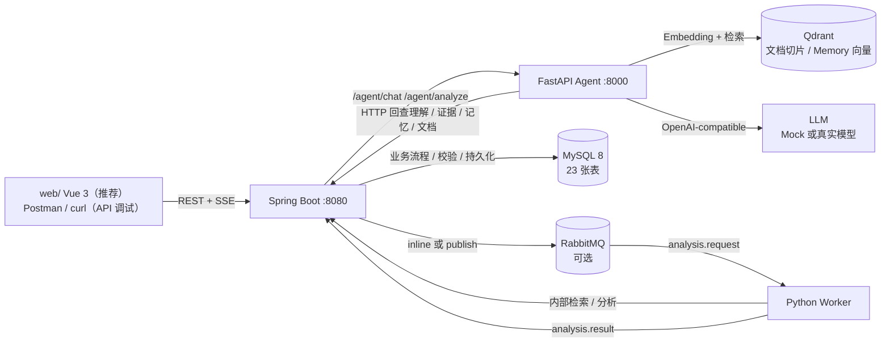

# AI Learning Space

> 一个能跨对话保留「学习者当前怎么理解某个知识点」、并用这些记录调整后续回答的
> AI Learning Agent。

**交付快照：** 2026-10-29（阶段 9，证据边界收口；功能冻结）；
**文档更新：** 2026-10-30（5.3 真实模型复验 + 服务端 E2E；5.4 MQ / 文档引用 /
重复采样 / 并发压测）；**封版对齐：** 2026-11-08（P0/P1/P2 修复、Vue 3 Web 客户端、
Memory 混合检索）

**状态：** 可本地复现的开发基线；**已完成真实模型 Agent 运行时复验（5 场景）**、
**Spring SSE → Agent → `deepseek-flash` 的真实服务端 E2E（3 轮 / 47 检查）**，
并在 5.4 补跑了 **MQ 真实模型（19 / 0）**、**Qdrant 文档引用（28 / 0）**、
**连续 3 轮重复采样（47 / 0 × 3）** 和 **单机并发基线（6/12、12/24、24/24，均 10 / 0）**。
但**不是**完整产品验收：Flutter 客户端仍未实现（Vue 3 Web 客户端已闭环）、
无人工评分 / 留存指标、无多实例与持续压测；5.4 的 MQ 轮还保留了真实模型
`ConnectError` + 非法 JSON 的失败样本。
总报告见
[docs/testing/phase54-real-model-20261030.md](docs/testing/phase54-real-model-20261030.md)，
5.3 证据见
[docs/testing/phase53-real-model-20261030.md](docs/testing/phase53-real-model-20261030.md)、
[docs/testing/phase53-spring-e2e-20261030.md](docs/testing/phase53-spring-e2e-20261030.md)。

**推荐客户端：** [`web/`](web/)（Vue 3 + Vite），已实现登录守卫、SSE 对话、文档管理、
记忆管理与学习状态查看。Postman / curl 仍可用于 API 调试；`flutter/` 仍是脚手架。
启动方式见 [docs/design/LOCAL_DEMO_GUIDE.md](docs/design/LOCAL_DEMO_GUIDE.md)。

---

## 1. 问题、目标用户与和普通 Chatbot 的区别

要解决的问题不是「回答一个知识点」，而是：

> AI 能不能记住这个用户**具体错在哪、什么时候被纠正、现在是否真的能讲清**，
> 并在下一次对话里区分「历史误区」和「当前掌握」？

目标用户是需要长期学习复杂概念、且愿意通过解释 / 批注 / 测试暴露理解过程的学习者。
当前实现用操作系统中的 **TLB（Translation Lookaside Buffer）** 作为主要演示概念。

和普通 Chatbot 的区别：

| | 普通 Chatbot | 只有知识库 RAG | 本项目 |
| --- | --- | --- | --- |
| 记住对话 | 会话内 | 不记住 | 跨会话保留学习状态 |
| 判断依据 | 模型自由推断 | 文档片段 | Evidence + 用户原话 + 显式批注 + 测试回答 |
| 历史变化 | 无 | 无 | 不可变 Revision 轨迹 |
| 下一次回答 | 重新讲 | 重新检索 | 当前 Understanding 优先，显式复盘才注入历史轨迹 |
| 出错时 | 难以追责 | 引用文档 | 可回跳到 Message / Highlight / Test Answer |

**关键区别：** 本项目不是「把聊天记录塞进 RAG」。Evidence 是追加事实，
Understanding 是当前快照，Revision 是不可变历史，三者不能互相覆盖。

---

## 2. 组件与运行时架构



完整职责、数据方向与调用边界见
[docs/delivery/ARCHITECTURE.md](docs/delivery/ARCHITECTURE.md)。

**一条重要边界：** Python Agent 不直接写 MySQL。Agent 只返回候选 / 回答，
Spring 做校验、去重和事务写入；数据库唯一约束是最终保证。

---

## 3. 各组件职责

| 组件 | 负责 | 不负责 |
| --- | --- | --- |
| **Spring Boot** | 认证 / JWT、空间与概念、对话与 SSE、Evidence 校验与去重、Understanding 演进、Revision、LearningState 投影、Memory 生命周期、文档上传与索引编排、inline/MQ 分派、内部检索接口 | 不生成教学内容，不做语义判断 |
| **FastAPI Agent** | 概念识别、检索（Fixture/HTTP）、上下文组装与预算、Tutor 回答、学习分析候选、引用校验、检索失败兜底、历史回答校验、文档解析/切片/Embedding、MQ Worker | 不直接持久化业务表，不决定权限 |
| **MySQL 8** | 23 张业务表；原始记录、append-only Evidence、当前 Understanding、不可变 Revision、LearningState 投影、Memory 元数据，以及 Memory 的 ngram FULLTEXT 词法索引 | 不承担向量相似度计算（Memory 向量路由 Qdrant） |
| **Qdrant** | 文档切片向量与 Memory 向量；collection 名为 `<prefix>_<model>_<dimension>` | 不存学习状态、不存 Memory 元数据；检索结果必须回 MySQL 复核 |
| **RabbitMQ** | 可选异步分析：request / result / retry TTL / DLQ | 不是默认链路；inline 模式不需要它 |
| **LLM** | Tutor 回答、学习分析候选 | 不是事实来源；没有 Key 时用 Mock |

Flutter 目录目前只有 `flutter create` 的计数器模板，没有登录、对话、SSE 或批注页面。

---

## 4. Evidence / Understanding / Revision / LearningState / Memory

| 概念 | 语义 | 可变性 | 代码 / 表 |
| --- | --- | --- | --- |
| 原始记录 | 用户原话、显式批注、测试回答 | 用户内容可软删；已产生的 Evidence 不随之删除 | `message` / `highlight` / `test_answer` |
| **Evidence** | 认知判断的原子依据，带来源 | **append-only**；`dedupe_key` 唯一索引 | `learning_evidence` + `evidence_source` |
| **LearningUnderstanding** | 用户「现在」怎么理解某个 Concept | 当前快照，可更新 | `learning_understanding` |
| **UnderstandingRevision** | 理解如何一步步变化 | **只插入，不更新 / 删除** | `understanding_revision` |
| **LearningState** | 面向 UI 的状态 / 复习时间 / 优先级 | 由 Understanding 单向投影 | `learning_state` |
| **Memory** | 为未来服务该用户而长期保留的偏好 / 学习方式 | 用 status 管生命周期，不物理删除 | `memory` + `memory_source` |

关键规则：

- Evidence 可以回跳到 `MESSAGE` / `HIGHLIGHT` / `TEST_ANSWER`；
- 误区状态只有 `ACTIVE` / `PENDING`；「已解除」= 从**当前快照**的误区数组移出，
  旧 Revision 仍保留当时的 `ACTIVE` 快照；
- `LearningState` 不产生第二种判断，只复制 `Understanding.status`；
- Memory 作用域是 `GLOBAL` / `SPACE` / `CONCEPT`，检索结果必须带来源与时间，
  不能被当成当前事实；
- 当前是否有误区只看 `learning_understanding.misconceptions`，不能拿旧 Revision 反推现在。

完整生命周期图与存储语义见
[docs/delivery/LEARNING_LIFECYCLE.md](docs/delivery/LEARNING_LIFECYCLE.md)。

---

## 5. 文档检索与学习状态如何分别进入上下文

`AgentRuntime.prepare()` 先识别概念，再分别取三类信息：

```text
用户问题
  ├── 文档检索（Qdrant）→ knowledge chunks + knowledge_status
  ├── 记忆检索（MySQL FULLTEXT + Qdrant + RRF）→ memory + memory_status
  └── 学习状态（Spring 回查）→ Understanding / Evidence
```

`ContextBuilder` 按优先级组装，预算不足时从低优先级开始丢弃：

| 优先级 | 区块 | 说明 |
| ---: | --- | --- |
| 100 | `user_input` | 本轮问题，永不被丢 |
| 90 | `history:*` | 本次对话最近消息 |
| 85 | `session` | 本阶段学习目标（懒创建） |
| 70 | `understanding:*` | 当前理解快照 |
| 68 | `trajectory:*` | **只在显式个人复盘时出现** |
| 50 | `memory:*` | 长期上下文，标注为历史记录 |
| 45 | `knowledge_status` | 检索成功 / 无文档 / 未命中 / 被阈值过滤 / 降级 |
| 40 | `knowledge:*` | 文档切片 |
| 20 | `evidence:*` | 判定依据；复盘时关联证据已在轨迹中，不重复注入 |

### 5.1 Memory 混合检索

长期记忆不再使用 `LIKE` 关键词匹配。Agent 调用
`GET /api/memories/search/hybrid`，链路为：

```text
keyword
  ├── MySQL FULLTEXT（ngram）──┐
  └── Qdrant 向量召回 ─────────┤→ RRF 融合 → MySQL 回源复核 → items + status
```

- 任一路失败会降级为单路，返回 `DEGRADED_VECTOR` / `DEGRADED_KEYWORD`；
- 两路都失败返回 `UNAVAILABLE`，绝不把「检索不可用」伪装成「没有记忆」；
- 空关键词返回 `BLANK_QUERY` 与可见列表；
- 回源复核再次施加 `user_id`、`status = ACTIVE` 与作用域可见性过滤，
  Qdrant 中的陈旧/越权数据不会直接进入 prompt；
- 旧 `GET /api/memories/search` 保留返回 `List` 的兼容契约，但**不携带降级状态**，
  新调用方应使用 `/search/hybrid`。

两条容易混淆的规则：

1. **普通知识问题**只注入当前 Understanding，不注入完整历史轨迹；
2. **显式个人复盘**（如「我之前错在哪，后来怎么纠正的」）才检索 Revision 轨迹，
   并把关联 Evidence 按时间渲染。触发词是启发式的，边界见第 10 节。

文档检索失败不是「假装成功」：`NO_VALID_DOCUMENTS` / `NO_MATCH` /
`THRESHOLD_FILTERED` / `DEGRADED` 会作为状态说明进入上下文，`evidence_guard`
只在知识问句上追加资料状态说明，不重写回答。

来源标注另有两条硬边界：

- 可引用集合只包含**本轮实际进入 system instruction** 的片段；被 Token 预算
  裁掉的片段即使还在检索结果里，它的 `资料《文件名》#序号` 也会被判非法；
- Runtime 在**流式生成阶段**就过滤越界 / 残缺标注（`agent/app/citation_filter.py`），
  不需要等整段回答完成；跨 delta 的标注会先缓冲拼完再判定，普通方括号文本
  不受影响。模型原本输出了什么仍记在 trace 的 `CITATION_FILTER` 事件里。

边界：过滤只处理可机器核对的来源标签，**不纠正自然语言误述**。检索成功但片段
被裁掉时，模型若仍说「没有检索到资料」，Runtime 不会用关键词规则改写它；
这一剩余风险见第 10 节。

---

## 6. inline 与 RabbitMQ 两条分析路径

两条路径都在**回答结束之后**运行，不阻塞 `message.delta`：

### inline（默认）

```text
Spring ChatService
  → 推完 SSE
  → AnalysisDispatchService.dispatch()
  → 调用 Agent /agent/analyze
  → 校验候选 → 写 Evidence → 演进 Understanding → 写 Revision → 投影 LearningState
```

优点是本地简单、无需 broker；缺点是分析占用后端线程池，突发分析会与回答争资源。

### RabbitMQ（可选）

```text
Spring ChatService
  → 推完 SSE
  → publish analysis.request（publisher confirm + mandatory）
  → Worker 消费、调用内部检索 / Agent 分析
  → publish analysis.result
  → Spring Result Consumer 校验后持久化
  → ACK；失败进 retry TTL 队列；超过重试进 DLQ
```

约束：

- 默认 `AILS_ANALYSIS_MODE=inline`；
- MQ 模式需要 RabbitMQ + Worker，且 `AILS_INTERNAL_TOKEN` 两端一致；
- 同一 `taskId` 重复投递不会产生第二条 Evidence / Revision；
- Agent 分析永久失败时 run 落 `FAILED`，由独立的 `rules-v1` 兜底 run 写一条
  `UNKNOWN` 观察，**不冒充 Agent 分析，也不推进掌握状态**；
- 当前没有多实例分布式协调，SSE 连接与分析线程池都是单进程假设。

队列拓扑、消息契约与失败分类见 [docs/analysis-mq.md](docs/analysis-mq.md)。

---

## 7. 本地启动：依赖、环境变量、建表与顺序

完整说明（含常见失败）见 [docs/delivery/ENVIRONMENT.md](docs/delivery/ENVIRONMENT.md)。

### 7.1 依赖与端口

| 依赖 | 版本 / 地址 | 必需 |
| --- | --- | --- |
| JDK | 17+ | 是 |
| Python | 3.10+ | 是 |
| Node.js | 20.19+ 或 22.12+（Vite 8 要求） | 仅 Web 前端 |
| MySQL | 8.x，`127.0.0.1:3306` | 是 |
| Qdrant | `http://127.0.0.1:6333` | 仅文档 RAG |
| RabbitMQ | `127.0.0.1:5672` / `15672` | 仅 MQ 模式 |
| Docker | 可选 | 仅 RabbitMQ / Testcontainers |

`docker/docker-compose.yml` **只包含 RabbitMQ**，不包含 MySQL 和 Qdrant。

### 7.2 启动顺序

```bash
# 1) MySQL 先可用。库不存在会自动创建；表由 schema.sql 幂等初始化。
#    本机密码不同时写入 backend/backend/src/main/resources/application-local.yml
#    （已被 .gitignore 排除，不要提交）。

# 2) Agent（默认 Mock + Fixture，不需要 Key）
cd agent
pip install -r requirements.txt
python -m app.main
# http://127.0.0.1:8000/health（存活探针）

# 3) Spring Boot（新终端）
cd backend/backend
# application-local.yml 写 ails.agent.gateway: http（默认 stub 不调用 Agent）
./mvnw spring-boot:run
# http://127.0.0.1:8080

# 4) Web 前端（新终端，推荐客户端）
cd web
npm install
npm run dev
# http://localhost:5173
```

前端默认连接 `http://localhost:8080`，可通过 `web/.env.development` 的
`VITE_API_BASE_URL` 覆盖。完整的注册 / 登录 / 上传 / 对话 / 记忆验收流程见
[docs/design/LOCAL_DEMO_GUIDE.md](docs/design/LOCAL_DEMO_GUIDE.md)。

Agent 关键环境变量：

| 变量 | 默认 | 说明 |
| --- | --- | --- |
| `AILS_LLM_PROVIDER` | `mock` | `mock` / `openai` |
| `AILS_LLM_API_KEY` | 空 | **只从 gitignored `.env` 或环境变量读取** |
| `AILS_RETRIEVER_MODE` | `auto` | 带 `authToken` 走 HTTP 回查，否则 Fixture |
| `AILS_EMBEDDING_PROVIDER` | `hash` | `hash` 仅开发；真实语义检索用 `openai` |
| `AILS_QDRANT_URL` | `http://127.0.0.1:6333` | 文档向量 |
| `AILS_INTERNAL_TOKEN` | 空 | Worker / 内部文档接口凭据 |

后端关键环境变量：

| 变量 | 默认 | 说明 |
| --- | --- | --- |
| `MYSQL_HOST` / `MYSQL_PORT` / `MYSQL_DB` | `localhost` / `3306` / `ails` | 数据库 |
| `MYSQL_USER` / `MYSQL_PASSWORD` | `root` / `root` | 本机不同写 local 文件 |
| `AILS_AGENT_GATEWAY` | `stub` | 改成 `http` 才调用 Agent |
| `AILS_AGENT_BASE_URL` | `http://127.0.0.1:8000` | Agent 地址 |
| `AILS_ANALYSIS_MODE` | `inline` | `inline` / `mq` |
| `AILS_INTERNAL_TOKEN` | 空 | 与 Agent / Worker 一致 |
| `JWT_SECRET` | 开发默认值 | 生产必须覆盖 |

### 7.3 建表与迁移

- 正常启动：`spring.sql.init` 每次执行 `schema.sql`。主体为
  `CREATE TABLE IF NOT EXISTS`，另有 `agent_run.status` 枚举的幂等 `ALTER`，
  可重复执行；但它不会为已有表补列 / 加索引，旧库升级仍必须手工迁移；
- **已有库升级**：`CREATE TABLE IF NOT EXISTS` 不会给旧表加列，必须按以下顺序手工执行
  （脚本均为幂等过程，可重复执行；建议先备份并停止后端）：
  1. `schema-migration-document-rag.sql` —— 文档 RAG 基础表 / 列；
  2. `schema-migration-rag-reliability.sql` —— 文档索引版本、Embedding 指纹、
     删除 / 巡检列（依赖上一步的 `document` / `document_chunk` 结构）；
  3. `schema-migration-memory-fulltext.sql` —— `memory.content` 的 ngram FULLTEXT
     索引与 `outbox_event` 表（Memory 词法检索与向量同步）；
  4. `schema-migration-phase7-truncation.sql` —— `message.truncated` 与
     `agent_run.status=TRUNCATED`；
  5. `schema-migration-phase3-citations.sql` —— `message.citations`
     （使用 `AFTER truncated`，必须在第 4 步之后，否则旧库会报 1054）；
  6. `schema-migration-phase54-message-seq.sql` —— `conversation.last_message_seq`，
     并按已有消息回填；
  7. `schema-migration-chat-idempotency.sql` —— `message.client_request_id`、
     `agent_run.client_request_id` / `assistant_message_id` 及两个幂等唯一键
     （Chat POST 幂等与预创建事务）；
- **顺序依赖**：`phase3-citations` 依赖 `phase7-truncation`；
  `rag-reliability` 依赖 `document-rag`；`memory-fulltext`、
  `phase54-message-seq`、`chat-idempotency` 与上述两组互不依赖；
- 执行示例（密码不要写进命令历史时改用 `MYSQL_PWD` 或本地配置文件）：

  ```bash
  mysql -h 127.0.0.1 -u root -p < backend/backend/src/main/resources/schema-migration-phase7-truncation.sql
  ```

  漏跑第 3 步时，Memory 关键词检索会因缺少 `ft_memory_content` FULLTEXT 索引失败，
  请求降级为向量路并返回 `DEGRADED_KEYWORD`；
  漏跑第 4 步时，新版 MyBatis 查询 `message.truncated` 会报
  `Unknown column 'truncated' in 'field list'`；漏跑第 5 步时，助手消息写入
  `message.citations` 会报 `Unknown column 'citations'`；漏跑第 6 步时，
  消息序号分配会报 `Unknown column 'last_message_seq'`；
- 清库重建：`schema-dev-reset.sql`（只 DROP）→ `schema.sql`，只能用于开发库；
- 没有 Flyway / Liquibase；迁移脚本不会被 Spring 自动执行。

### 7.4 MQ 模式（可选）

```bash
cd docker && docker compose up -d          # RabbitMQ only

# 后端 8081
cd backend/backend
SERVER_PORT=8081 AILS_ANALYSIS_MODE=mq \
  AILS_ANALYSIS_COMPENSATION_ENABLED=false \
  AILS_INTERNAL_TOKEN=<token> ./mvnw spring-boot:run

# Worker
cd agent
AILS_INTERNAL_TOKEN=<token> python -m app.worker
```

---

## 8. 单元 / 集成 / E2E 怎么执行

完整矩阵与每条结果的性质见 [docs/delivery/TEST_MATRIX.md](docs/delivery/TEST_MATRIX.md)。
**不要把不同时间、不同评分规则、不同测试语义的通过率相加。**

```bash
# Agent 单元 / 集成（2026-11-08：437 passed, 9 skipped, 1 xfailed）
cd agent && python -m pytest -q

# 来源过滤定向回归
cd agent && python -m pytest tests/test_citation_filter.py \
  tests/test_runtime_budget_contract.py tests/test_runtime_citations.py -q

# Spring 单元 / 集成（2026-11-08：388 运行 / 300 执行通过 / 88 跳过 / 0 失败）
cd backend/backend && ./mvnw test

# Spring MQ Testcontainers 集成（需要 Docker；本轮未执行）
cd backend/backend && ./mvnw -B clean test -Pmq-integration

# 离线回归评测（不需要外部服务；当前 40/40，断言 124/124）
python -m evaluation

# 全量 online 评测（需要 MySQL + 两个服务；本轮未重跑）
python -m evaluation --mode all

# inline E2E（8080 + Agent 8000，Mock）
bash scripts/phase51-e2e.sh

# 5.2 学习轨迹 E2E（Mock）
bash scripts/phase52-e2e.sh

# MQ E2E（8081 + Worker + RabbitMQ；要求没有其他 Worker 在消费）
BACKEND_LOG=/path/to/backend-mq.log bash scripts/phase51-mq-e2e.sh

# 5.3 服务端 E2E（8081 + Agent 8000 + 真实 deepseek-flash）
python scripts/phase53-spring-e2e.py \
  --base http://127.0.0.1:8081 --agent http://127.0.0.1:8000

# 5.4 文档引用 E2E（Spring 8081 + Agent 8000 + 真实 Qdrant / Embedding / LLM）
python scripts/phase54-rag-citation-e2e.py \
  --base http://127.0.0.1:8081 --agent http://127.0.0.1:8000

# 5.4 MQ 真实模型 E2E（Spring 8082 + Agent 8001 + 独立 Phase54 拓扑；脚本自启停 Worker）
python scripts/phase54-mq-real-e2e.py \
  --base http://127.0.0.1:8082 --agent http://127.0.0.1:8001 \
  --backend-log /path/to/backend-8082.log

# 5.4 并发基线（默认 6 并发 / 12 总请求；真实模型）
python scripts/phase54-concurrency-e2e.py \
  --base http://127.0.0.1:8081 --concurrency 6 --total 12

# 阶段 6 TLB 演示（Mock，自动建新用户 / 新空间）
bash scripts/phase6-demo.sh
```

前置条件、独立测试库和产物路径见
[docs/testing/phase54-real-model-20261030.md](docs/testing/phase54-real-model-20261030.md)。

结果口径：

| 层级 | 最近结果 | 性质 |
| --- | --- | --- |
| Agent（2026-11-08） | 437 passed / 9 skipped / 1 xfailed | Mock + 单元；skip 是环境门控；1 个 xfail 是已记录的自然语言误述风险 |
| Spring（2026-11-08） | 388 条（300 执行通过 / 88 跳过 / 0 失败） | Surefire 的 `Tests run` 含 skip，不能写成 388 passed；skip 需要真实 MySQL / Docker |
| 5.1 inline E2E | 101 / 0 / 0 | Mock |
| 5.1 MQ E2E | 27 / 0 / 0 | Mock LLM + 真 RabbitMQ + 真 Worker |
| 5.2 学习轨迹 E2E | 94 / 0 / 0 | Mock |
| 5.3 服务端 E2E（2026-10-30） | **47 / 0 / 0** | Spring SSE → Agent → 真实 `deepseek-flash` |
| 5.4 重复采样（2026-10-30） | **47 / 0 / 0 × 3 轮** | 同一服务端场景连续重跑；非统计采样 |
| 5.4 Qdrant 文档引用（2026-10-30） | **28 / 0 / 0** | 真实 Qdrant + Embedding + `deepseek-flash` |
| 5.4 MQ 真实模型（2026-10-30） | **19 / 0 / 0** | 真 RabbitMQ + Worker + 真实模型；另有 15/4 失败样本 |
| 5.4 并发基线（2026-10-30） | **10 / 0 / 0 × 3 组** | 6/12、12/24、24/24；单机单实例 |
| 离线评测 | 40/40，124/124 断言 | 不调用模型 |
| RAG / 5.3 | 真实模型结果，失败样本保留 | 见测试矩阵 |

“skipped” 不等于通过；“0 executed” 不写成通过；Mock 链路不等于真实模型验收。

---

## 9. 真实模型与 Mock 的边界

| 场景 | 当前状态 | 能说明什么 |
| --- | --- | --- |
| 单元 / E2E / 演示 | **Mock LLM** | 检索、上下文、持久化、SSE、状态流转 |
| RAG 评测（2026-10-26） | 真实 `qwen-plus` | 检索与引用表现；不是教学效果 |
| 5.3 真实模型行为（2026-10-27 历史） | 8 次调用 | A/D 通过，B `PARTIAL`，C `FAIL`；失败样本保留 |
| 5.3 真实模型复验（2026-10-30） | **6 次调用 / 5 场景** | A/B/C/D `PASS`；C-only `PASS`（fallback）；见复验报告 |
| 5.3 服务端 E2E（2026-10-30） | **3 轮聊天 + 3 次 inline 分析，47 / 0** | Spring SSE 契约、消息 / run 落库、真实模型分析、显式复盘上下文均通过 |
| 5.3.2 历史回答复验（2026-10-30） | **已用真实模型复验** | C 不再编造原因；C-only 被否定句误判后走 fallback |
| 5.4 重复采样（2026-10-30） | **3 轮 × 47 / 0** | 修复 `message.end` 早于 run 终态的顺序竞态后连续通过 |
| 5.4 文档引用（2026-10-30） | **28 / 0** | 真实 Qdrant / Embedding / LLM；回答可带可回跳标签，无关问题不引用 |
| 5.4 MQ 真实模型（2026-10-30） | **19 / 0；另有 15 / 4 失败样本** | 真 broker + Worker + 真实模型；失败样本是供应商连接 / JSON 错误 |
| 5.4 并发（2026-10-30） | **3 组 × 10 / 0** | 6/12、12/24、24/24；修复消息序号与 Session 归属死锁 |
| 真实 Qdrant / broker / MySQL 集成 | 5（Agent）+ 73（Spring）个环境门控 skip | 本轮未执行 |

真实模型切换方式：

```bash
AILS_LLM_PROVIDER=openai
AILS_LLM_BASE_URL=https://api.deepseek.com/v1
AILS_LLM_MODEL=deepseek-flash
AILS_LLM_MAX_TOKENS=4096
AILS_LLM_API_KEY=<从本地 gitignored 配置或环境变量注入>
```

`provider=openai` 但缺 Key 时启动即报错，不会静默退回 Mock。
Embedding 同理，不会从 `openai` 静默退回 `hash`。

**2026-10-30 复验结论：** 真实模型在 A/B/C/D 四个场景中不再编造未记录的学习过程；
C-only 的模型回答也正确拒绝了编造，但被 `history_guard` 的否定句规则误判，
最终由确定性 fallback 交付。因此可以写「已完成单轮真实模型行为复验」，
但不能写「真实模型已稳定遵守证据边界」：C-only 依赖 fallback，且只跑了一轮。
完整证据见 [docs/testing/phase53-real-model-20261030.md](docs/testing/phase53-real-model-20261030.md)。

**2026-10-30 服务端 E2E：** 另起 8081 后端 + 8000 真实模型 Agent，通过公开 API 完成
普通问题、错误解释、显式复盘 3 轮，47 / 0 通过；`message.start → delta → end`、
消息 / `agent_run` 落库、inline 分析 `agent-v1`、显式复盘 `trajectory` 注入均核对。
首轮还暴露并修复了一个真实模型契约漂移：`verificationDecision.trigger` 被模型写成
自由文本，导致整轮分析失败并退回 `rules-v1`；修复后重新验收通过。证据见
[docs/testing/phase53-spring-e2e-20261030.md](docs/testing/phase53-spring-e2e-20261030.md)。

**2026-10-30 阶段 5.4：** 补跑了 5.3 未覆盖的四类链路。文档引用 28 / 0，
MQ 真实模型 19 / 0，重复采样 3 轮 47 / 0，并发 6/12、12/24、24/24 均为 10 / 0。
压测暴露并修复了两个死锁（消息序号索引间隙锁、首次 Session 归属的外键 S→X 升级）
和一个顺序竞态（`message.end` 早于 `agent_run` 终态）。MQ 另有一轮 15 / 4：
Worker 首次 `ConnectError`、重试返回非法 JSON，run 落 `FAILED` 并由 `rules-v1`
兜底，失败样本保留。**这不代表 Flutter、人工评分、多实例或持续压测已验收。**
完整报告见
[docs/testing/phase54-real-model-20261030.md](docs/testing/phase54-real-model-20261030.md)。

---

## 10. 已知缺陷、验收边界与运行限制

详见 [docs/delivery/KNOWN_LIMITATIONS.md](docs/delivery/KNOWN_LIMITATIONS.md)。摘要：

- **真实模型已做 Runtime 复验 + 服务端 E2E + MQ / 文档引用 / 重复采样 / 并发，
  但仍不是完整产品验收**：5 场景 A/B/C/D `PASS`、C-only 依赖 fallback；服务端 3 轮
  47 / 0；5.4 的 MQ 19 / 0、文档引用 28 / 0、重复采样 3 × 47 / 0、并发 3 × 10 / 0。
  Flutter、人工评分 / 留存指标、多实例和持续压测仍未执行；`deepseek-flash` 在
  `max_tokens=1024` 时会截断长回答，本轮已改为 4096；
- **真实模型仍不稳定**：5.4 MQ 轮出现 `ConnectError` + 非法 JSON，run 落 `FAILED`
  并由 `rules-v1` 兜底；并发轮出现上游 `RemoteProtocolError`，单个请求约 80 s 后
  `message.error`。这些是供应商 / 网络问题，不是本轮数据库死锁；
- **并发只到 24 个短问题**：单机、单实例、默认线程池，没有 SLO、持续负载、断线重连
  或限流验证；不能写成「已通过压测」；
- **历史校验是句子级启发式**：不能覆盖所有同义改写；非常规措辞可能不触发复盘；
  C-only 已出现「不能反过来断言你以前没有这个错误」被误判为 `no_history_denial`
  的真实误报，导致一次多余重生成并最终 fallback；
  显式复盘首字延迟被推迟到完整回答生成后，触发重生成时约等于两次生成；
- **Web 前端已闭环，但不是完整产品前端**：`web/` 已实现登录守卫、SSE 对话、
  文档管理、记忆管理与学习状态查看；注册与学习空间管理仍需调用 API（MVP），
  Flutter 仍是计数器脚手架；
- **业务缺口**：导出 / 导入 / 学习计划返回 501；测试判分是长度 + 概念名启发式；
  `run_type=MEMORY` 没有调用方；inline 分析与聊天共用线程池；
  复习调度是硬编码状态映射；
- **检索限制**：文档 RAG 仍是 `top_k=5`、`min_score=0.35`，没有 Reranker /
  文档侧 Hybrid Search；Memory 使用 MySQL FULLTEXT + Qdrant 向量 + RRF 融合，
  但向量路依赖 Agent / Qdrant，不可用时降级为词法路；引用校验是格式 + 词面启发式，
  不是事实正确性证明；
- **来源交付边界已收口，但语义误述仍开放**：越界引用在流式阶段被丢弃，
  被裁剪片段不能作为有效来源；但「检索成功、片段被裁掉」时模型仍可能用自然语言
  说「没有检索到资料」。Runtime 只能保证确定性的检索 / 注入状态与引用 ID，
  不能在不做关键词拦截的前提下识别任意同义表述；该风险以 strict XFAIL 记录，
  **不声称已修复**；
- **流式过滤的代价**：越界标注被丢弃后，标注前的空白不会被回撤（已发送的文本
  无法撤回），可能出现「字 空格。」这类轻微排版痕迹；标注本身不会泄漏；
- **数据库 / 部署**：没有 Flyway / Liquibase，`schema.sql` 随应用启动执行
  （开发便利，生产应关闭启动 DDL）；已有库必须按 7.3 的顺序手工执行迁移；
  单进程假设；RabbitMQ 只有本地 compose；
- **运维边界**：文档删除若遇到本地 IO 异常，数据库已标记删除但物理文件可能残留，
  目前依赖人工巡检；Agent 的 Memory 版本防回退使用进程内锁，多实例部署需改为
  分布式锁。详见
  [docs/audit/KNOWN_LIMITATIONS.md](docs/audit/KNOWN_LIMITATIONS.md)；
- **测试限制**：序号分配与 Session 首次归属目前由 E2E / 并发脚本覆盖，没有专门的
  单元回归；GitHub Actions CI 本轮未触发；`--mode all` 与
  `scripts/regress-closed-loop.sh` 本轮未重跑；Flutter 测试未执行。

---

## 11. 交付文档与演示

| 文档 | 内容 |
| --- | --- |
| [docs/delivery/ARCHITECTURE.md](docs/delivery/ARCHITECTURE.md) | 运行时 / 服务架构、数据方向、未实现能力 |
| [docs/delivery/LEARNING_LIFECYCLE.md](docs/delivery/LEARNING_LIFECYCLE.md) | 学习状态生命周期、存储语义、误区解除 |
| [docs/delivery/DEMO.md](docs/delivery/DEMO.md) | TLB 七步可重复演示（明确标注 Mock） |
| [docs/delivery/ENVIRONMENT.md](docs/delivery/ENVIRONMENT.md) | 依赖、启动顺序、环境变量、建表 / 迁移 |
| [docs/design/LOCAL_DEMO_GUIDE.md](docs/design/LOCAL_DEMO_GUIDE.md) | Web + Spring 本地启动与端到端联调（注册 / 上传 / 对话 / 记忆） |
| [docs/delivery/TEST_MATRIX.md](docs/delivery/TEST_MATRIX.md) | 测试 / 质量矩阵与报告索引 |
| [docs/delivery/KNOWN_LIMITATIONS.md](docs/delivery/KNOWN_LIMITATIONS.md) | 已知限制、未完成验收、不要做的事 |
| [docs/audit/KNOWN_LIMITATIONS.md](docs/audit/KNOWN_LIMITATIONS.md) | 三阶段审查 + 封版前确认的残余风险与部署边界 |
| [docs/testing/phase54-real-model-20261030.md](docs/testing/phase54-real-model-20261030.md) | Phase 5.4：MQ 真实模型、文档引用、重复采样、并发压测与死锁修复 |
| [docs/testing/phase9-evidence-boundary.md](docs/testing/phase9-evidence-boundary.md) | Phase 9：来源过滤、知识状态边界、测试与契约清单 |
| [docs/delivery/GIT_WORKSPACE.md](docs/delivery/GIT_WORKSPACE.md) | 文件分类、工作区风险、提交建议（不自动提交） |
| [docs/delivery/INTERVIEW.md](docs/delivery/INTERVIEW.md) | 面试讲解提纲：核心设计、关键缺陷、修复 |
| [docs/analysis-mq.md](docs/analysis-mq.md) | 分析队列拓扑与可靠性 |
| [docs/session-design.md](docs/session-design.md) | Session 设计 |
| [docs/database&API_design.md](docs/database&API_design.md) | 数据库 / API 设计 |

一条命令复现演示：

```bash
bash scripts/phase6-demo.sh
```

它从新用户、新空间开始，通过公开 API 完成「错误理解 → Evidence → Revision →
纠正 → 新会话 → 显式复盘」，最后只读查库核对，不需要手工改数据。

---

## 12. 最重要的一句话

> **当前回答依赖 Conversation，个性化依赖 Understanding，长期连续性依赖 Memory，
> 所有学习判断依赖 Evidence。**
