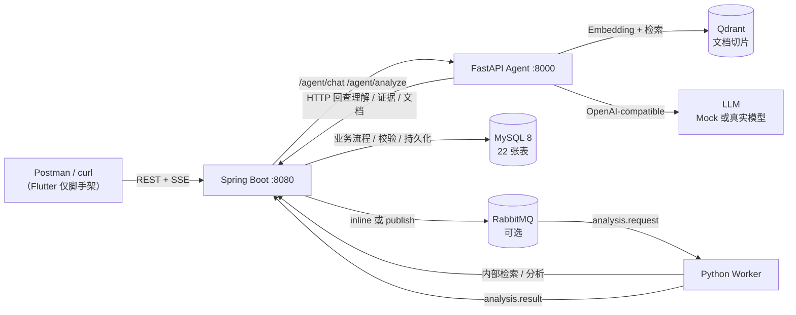

# AI Learning Space

> 一个能跨对话保留「学习者当前怎么理解某个知识点」、并用这些记录调整后续回答的
> AI Learning Agent。

**交付快照：** 2026-10-27（阶段 6，功能冻结）

**状态：** 可本地复现的开发基线；**不是**已完成真实模型验收的产品版本。

**当前客户端：** Postman / curl。`flutter/` 仍是脚手架，见第 10 节。

---

## 1. 问题、目标用户与和普通 Chatbot 的区别

要解决的问题不是「回答一个知识点」，而是：

> AI 能不能记住这个用户**具体错在哪、什么时候被纠正、现在是否真的能讲清**，
> 并在下一次对话里区分「历史误区」和「当前掌握」？

目标用户是需要长期学习复杂概念、且愿意通过解释 / 批注 / 测试暴露理解过程的学习者。
当前实现用操作系统中的 **TLB（Translation Lookaside Buffer）** 作为主要演示概念。

和普通 Chatbot 的区别：

| | 普通 Chatbot | 只有知识库 RAG | 本项目 |
| --- | --- | --- | --- |
| 记住对话 | 会话内 | 不记住 | 跨会话保留学习状态 |
| 判断依据 | 模型自由推断 | 文档片段 | Evidence + 用户原话 + 显式批注 + 测试回答 |
| 历史变化 | 无 | 无 | 不可变 Revision 轨迹 |
| 下一次回答 | 重新讲 | 重新检索 | 当前 Understanding 优先，显式复盘才注入历史轨迹 |
| 出错时 | 难以追责 | 引用文档 | 可回跳到 Message / Highlight / Test Answer |

**关键区别：** 本项目不是「把聊天记录塞进 RAG」。Evidence 是追加事实，
Understanding 是当前快照，Revision 是不可变历史，三者不能互相覆盖。

---

## 2. 组件与运行时架构



完整职责、数据方向与调用边界见
[docs/delivery/ARCHITECTURE.md](docs/delivery/ARCHITECTURE.md)。

**一条重要边界：** Python Agent 不直接写 MySQL。Agent 只返回候选 / 回答，
Spring 做校验、去重和事务写入；数据库唯一约束是最终保证。

---

## 3. 各组件职责

| 组件 | 负责 | 不负责 |
| --- | --- | --- |
| **Spring Boot** | 认证 / JWT、空间与概念、对话与 SSE、Evidence 校验与去重、Understanding 演进、Revision、LearningState 投影、Memory 生命周期、文档上传与索引编排、inline/MQ 分派、内部检索接口 | 不生成教学内容，不做语义判断 |
| **FastAPI Agent** | 概念识别、检索（Fixture/HTTP）、上下文组装与预算、Tutor 回答、学习分析候选、引用校验、检索失败兜底、历史回答校验、文档解析/切片/Embedding、MQ Worker | 不直接持久化业务表，不决定权限 |
| **MySQL 8** | 22 张业务表；原始记录、append-only Evidence、当前 Understanding、不可变 Revision、LearningState 投影、Memory | 不做向量检索（Memory 当前是关键词 `LIKE`） |
| **Qdrant** | 文档切片向量；collection 名为 `<prefix>_<model>_<dimension>` | 不存学习状态、不存 Memory |
| **RabbitMQ** | 可选异步分析：request / result / retry TTL / DLQ | 不是默认链路；inline 模式不需要它 |
| **LLM** | Tutor 回答、学习分析候选 | 不是事实来源；没有 Key 时用 Mock |

Flutter 目录目前只有 `flutter create` 的计数器模板，没有登录、对话、SSE 或批注页面。

---

## 4. Evidence / Understanding / Revision / LearningState / Memory

| 概念 | 语义 | 可变性 | 代码 / 表 |
| --- | --- | --- | --- |
| 原始记录 | 用户原话、显式批注、测试回答 | 用户内容可软删；已产生的 Evidence 不随之删除 | `message` / `highlight` / `test_answer` |
| **Evidence** | 认知判断的原子依据，带来源 | **append-only**；`dedupe_key` 唯一索引 | `learning_evidence` + `evidence_source` |
| **LearningUnderstanding** | 用户「现在」怎么理解某个 Concept | 当前快照，可更新 | `learning_understanding` |
| **UnderstandingRevision** | 理解如何一步步变化 | **只插入，不更新 / 删除** | `understanding_revision` |
| **LearningState** | 面向 UI 的状态 / 复习时间 / 优先级 | 由 Understanding 单向投影 | `learning_state` |
| **Memory** | 为未来服务该用户而长期保留的偏好 / 学习方式 | 用 status 管生命周期，不物理删除 | `memory` + `memory_source` |

关键规则：

- Evidence 可以回跳到 `MESSAGE` / `HIGHLIGHT` / `TEST_ANSWER`；
- 误区状态只有 `ACTIVE` / `PENDING`；「已解除」= 从**当前快照**的误区数组移出，
  旧 Revision 仍保留当时的 `ACTIVE` 快照；
- `LearningState` 不产生第二种判断，只复制 `Understanding.status`；
- Memory 作用域是 `GLOBAL` / `SPACE` / `CONCEPT`，检索结果必须带来源与时间，
  不能被当成当前事实；
- 当前是否有误区只看 `learning_understanding.misconceptions`，不能拿旧 Revision 反推现在。

完整生命周期图与存储语义见
[docs/delivery/LEARNING_LIFECYCLE.md](docs/delivery/LEARNING_LIFECYCLE.md)。

---

## 5. 文档检索与学习状态如何分别进入上下文

`AgentRuntime.prepare()` 先识别概念，再分别取两类信息：

```text
用户问题
  ├── 文档检索（Qdrant）→ knowledge chunks + knowledge_status
  └── 学习状态（Spring 回查）→ Understanding / Memory / Evidence
```

`ContextBuilder` 按优先级组装，预算不足时从低优先级开始丢弃：

| 优先级 | 区块 | 说明 |
| ---: | --- | --- |
| 100 | `user_input` | 本轮问题，永不被丢 |
| 90 | `history:*` | 本次对话最近消息 |
| 85 | `session` | 本阶段学习目标（懒创建） |
| 70 | `understanding:*` | 当前理解快照 |
| 68 | `trajectory:*` | **只在显式个人复盘时出现** |
| 50 | `memory:*` | 长期上下文，标注为历史记录 |
| 45 | `knowledge_status` | 检索成功 / 无文档 / 未命中 / 被阈值过滤 / 降级 |
| 40 | `knowledge:*` | 文档切片 |
| 20 | `evidence:*` | 判定依据；复盘时关联证据已在轨迹中，不重复注入 |

两条容易混淆的规则：

1. **普通知识问题**只注入当前 Understanding，不注入完整历史轨迹；
2. **显式个人复盘**（如「我之前错在哪，后来怎么纠正的」）才检索 Revision 轨迹，
   并把关联 Evidence 按时间渲染。触发词是启发式的，边界见第 10 节。

文档检索失败不是「假装成功」：`NO_VALID_DOCUMENTS` / `NO_MATCH` /
`THRESHOLD_FILTERED` / `DEGRADED` 会作为状态说明进入上下文，`evidence_guard`
只在知识问句上追加资料状态说明，不重写回答。

---

## 6. inline 与 RabbitMQ 两条分析路径

两条路径都在**回答结束之后**运行，不阻塞 `message.delta`：

### inline（默认）

```text
Spring ChatService
  → 推完 SSE
  → AnalysisDispatchService.dispatch()
  → 调用 Agent /agent/analyze
  → 校验候选 → 写 Evidence → 演进 Understanding → 写 Revision → 投影 LearningState
```

优点是本地简单、无需 broker；缺点是分析占用后端线程池，突发分析会与回答争资源。

### RabbitMQ（可选）

```text
Spring ChatService
  → 推完 SSE
  → publish analysis.request（publisher confirm + mandatory）
  → Worker 消费、调用内部检索 / Agent 分析
  → publish analysis.result
  → Spring Result Consumer 校验后持久化
  → ACK；失败进 retry TTL 队列；超过重试进 DLQ
```

约束：

- 默认 `AILS_ANALYSIS_MODE=inline`；
- MQ 模式需要 RabbitMQ + Worker，且 `AILS_INTERNAL_TOKEN` 两端一致；
- 同一 `taskId` 重复投递不会产生第二条 Evidence / Revision；
- Agent 分析永久失败时 run 落 `FAILED`，由独立的 `rules-v1` 兜底 run 写一条
  `UNKNOWN` 观察，**不冒充 Agent 分析，也不推进掌握状态**；
- 当前没有多实例分布式协调，SSE 连接与分析线程池都是单进程假设。

队列拓扑、消息契约与失败分类见 [docs/analysis-mq.md](docs/analysis-mq.md)。

---

## 7. 本地启动：依赖、环境变量、建表与顺序

完整说明（含常见失败）见 [docs/delivery/ENVIRONMENT.md](docs/delivery/ENVIRONMENT.md)。

### 7.1 依赖与端口

| 依赖 | 版本 / 地址 | 必需 |
| --- | --- | --- |
| JDK | 17+ | 是 |
| Python | 3.10+ | 是 |
| MySQL | 8.x，`127.0.0.1:3306` | 是 |
| Qdrant | `http://127.0.0.1:6333` | 仅文档 RAG |
| RabbitMQ | `127.0.0.1:5672` / `15672` | 仅 MQ 模式 |
| Docker | 可选 | 仅 RabbitMQ / Testcontainers |

`docker/docker-compose.yml` **只包含 RabbitMQ**，不包含 MySQL 和 Qdrant。

### 7.2 启动顺序

```bash
# 1) MySQL 先可用。库不存在会自动创建；表由 schema.sql 幂等初始化。
#    本机密码不同时写入 backend/backend/src/main/resources/application-local.yml
#    （已被 .gitignore 排除，不要提交）。

# 2) Agent（默认 Mock + Fixture，不需要 Key）
cd agent
pip install -r requirements.txt
python -m app.main
# http://127.0.0.1:8000/health

# 3) Spring Boot（新终端）
cd backend/backend
# application-local.yml 写 ails.agent.gateway: http（默认 stub 不调用 Agent）
./mvnw spring-boot:run
# http://127.0.0.1:8080
```

Agent 关键环境变量：

| 变量 | 默认 | 说明 |
| --- | --- | --- |
| `AILS_LLM_PROVIDER` | `mock` | `mock` / `openai` |
| `AILS_LLM_API_KEY` | 空 | **只从 gitignored `.env` 或环境变量读取** |
| `AILS_RETRIEVER_MODE` | `auto` | 带 `authToken` 走 HTTP 回查，否则 Fixture |
| `AILS_EMBEDDING_PROVIDER` | `hash` | `hash` 仅开发；真实语义检索用 `openai` |
| `AILS_QDRANT_URL` | `http://127.0.0.1:6333` | 文档向量 |
| `AILS_INTERNAL_TOKEN` | 空 | Worker / 内部文档接口凭据 |

后端关键环境变量：

| 变量 | 默认 | 说明 |
| --- | --- | --- |
| `MYSQL_HOST` / `MYSQL_PORT` / `MYSQL_DB` | `localhost` / `3306` / `ails` | 数据库 |
| `MYSQL_USER` / `MYSQL_PASSWORD` | `root` / `root` | 本机不同写 local 文件 |
| `AILS_AGENT_GATEWAY` | `stub` | 改成 `http` 才调用 Agent |
| `AILS_AGENT_BASE_URL` | `http://127.0.0.1:8000` | Agent 地址 |
| `AILS_ANALYSIS_MODE` | `inline` | `inline` / `mq` |
| `AILS_INTERNAL_TOKEN` | 空 | 与 Agent / Worker 一致 |
| `JWT_SECRET` | 开发默认值 | 生产必须覆盖 |

### 7.3 建表与迁移

- 正常启动：`spring.sql.init` 每次执行 `schema.sql`，全部 `CREATE TABLE IF NOT EXISTS`，幂等；
- **已有库升级**：`CREATE TABLE IF NOT EXISTS` 不会给旧表加列，必须手工执行
  `schema-migration-document-rag.sql`；
- 清库重建：`schema-dev-reset.sql`（只 DROP）→ `schema.sql`，只能用于开发库；
- 没有 Flyway / Liquibase。

### 7.4 MQ 模式（可选）

```bash
cd docker && docker compose up -d          # RabbitMQ only

# 后端 8081
cd backend/backend
SERVER_PORT=8081 AILS_ANALYSIS_MODE=mq \
  AILS_ANALYSIS_COMPENSATION_ENABLED=false \
  AILS_INTERNAL_TOKEN=<token> ./mvnw spring-boot:run

# Worker
cd agent
AILS_INTERNAL_TOKEN=<token> python -m app.worker
```

---

## 8. 单元 / 集成 / E2E 怎么执行

完整矩阵与每条结果的性质见 [docs/delivery/TEST_MATRIX.md](docs/delivery/TEST_MATRIX.md)。
**不要把不同时间、不同评分规则、不同测试语义的通过率相加。**

```bash
# Agent 单元 / 集成（当前 232 passed, 5 skipped）
cd agent && python -m pytest -q

# Spring 单元（当前 189 passed, 29 skipped, 0 failed）
cd backend/backend && ./mvnw test

# Spring MQ Testcontainers 集成（需要 Docker；本轮未执行）
cd backend/backend && ./mvnw -B clean test -Pmq-integration

# 离线回归评测（不需要外部服务；当前 40/40，断言 124/124）
python -m evaluation

# 全量 online 评测（需要 MySQL + 两个服务；本轮未重跑）
python -m evaluation --mode all

# inline E2E（8080 + Agent 8000，Mock）
bash scripts/phase51-e2e.sh

# 5.2 学习轨迹 E2E（Mock）
bash scripts/phase52-e2e.sh

# MQ E2E（8081 + Worker + RabbitMQ；要求没有其他 Worker 在消费）
BACKEND_LOG=/path/to/backend-mq.log bash scripts/phase51-mq-e2e.sh

# 阶段 6 TLB 演示（Mock，自动建新用户 / 新空间）
bash scripts/phase6-demo.sh
```

结果口径：

| 层级 | 最近结果 | 性质 |
| --- | --- | --- |
| Agent | 232 passed / 5 skipped | Mock + 单元；5 个 skip 是环境门控 |
| Spring | 189 passed / 29 skipped / 0 failed | 单元；29 个 skip 需要真实 MySQL / Docker |
| 5.1 inline E2E | 101 / 0 / 0 | Mock |
| 5.1 MQ E2E | 27 / 0 / 0 | Mock LLM + 真 RabbitMQ + 真 Worker |
| 5.2 学习轨迹 E2E | 94 / 0 / 0 | Mock |
| 离线评测 | 40/40，124/124 断言 | 不调用模型 |
| RAG / 5.3 | 真实模型结果，失败样本保留 | 见测试矩阵 |

“skipped” 不等于通过；“0 executed” 不写成通过；Mock 链路不等于真实模型验收。

---

## 9. 真实模型与 Mock 的边界

| 场景 | 当前状态 | 能说明什么 |
| --- | --- | --- |
| 单元 / E2E / 演示 | **Mock LLM** | 检索、上下文、持久化、SSE、状态流转 |
| RAG 评测（2026-10-26） | 真实 `qwen-plus` | 检索与引用表现；不是教学效果 |
| 5.3 真实模型行为 | 8 次调用 | A/D 通过，B `PARTIAL`，C `FAIL` |
| 5.3.2 历史回答复验 | **0 次真实调用** | 只有离线回放和 Mock SSE；不能声称 C 已通过 |
| 真实 Qdrant / broker / MySQL 集成 | 5 + 29 个环境门控 skip | 本轮未执行 |

真实模型切换方式：

```bash
AILS_LLM_PROVIDER=openai
AILS_LLM_BASE_URL=https://dashscope.aliyuncs.com/compatible-mode/v1
AILS_LLM_MODEL=qwen-plus
AILS_LLM_API_KEY=<从本地 gitignored 配置或环境变量注入>
```

`provider=openai` 但缺 Key 时启动即报错，不会静默退回 Mock。
Embedding 同理，不会从 `openai` 静默退回 `hash`。

**未完成验收的结论：** 历史回答校验器能拦截已知失败样本，但真实模型下次是否合规
未被验证；因此不能把「历史回答已可靠遵守证据边界」写成交付结论。

---

## 10. 已知缺陷、未完成验收与运行限制

详见 [docs/delivery/KNOWN_LIMITATIONS.md](docs/delivery/KNOWN_LIMITATIONS.md)。摘要：

- **真实模型验收未完成**：5.3.2 为 0 次调用；5.3 的 C 仍 `FAIL`，B 为 `PARTIAL`；
- **历史校验是句子级启发式**：不能覆盖所有同义改写；非常规措辞可能不触发复盘；
  显式复盘首字延迟被推迟到完整回答生成后，触发重生成时约等于两次生成；
- **Flutter 前端未实现**：仍是计数器脚手架；
- **业务缺口**：导出 / 导入 / 学习计划返回 501；测试判分是长度 + 概念名启发式；
  Memory 检索是关键词 `LIKE`，没有向量召回；`run_type=MEMORY` 没有调用方；
  inline 分析与聊天共用线程池；复习调度是硬编码状态映射；
- **检索限制**：`top_k=5`、`min_score=0.35`，没有 Reranker / Hybrid Search；
  引用校验是格式 + 词面启发式，不是事实正确性证明；
- **数据库 / 部署**：没有迁移框架；单进程假设；RabbitMQ 只有本地 compose；
- **测试限制**：GitHub Actions CI 本轮未触发；`--mode all` 与
  `scripts/regress-closed-loop.sh` 本轮未重跑；Flutter 测试未执行。

---

## 11. 交付文档与演示

| 文档 | 内容 |
| --- | --- |
| [docs/delivery/ARCHITECTURE.md](docs/delivery/ARCHITECTURE.md) | 运行时 / 服务架构、数据方向、未实现能力 |
| [docs/delivery/LEARNING_LIFECYCLE.md](docs/delivery/LEARNING_LIFECYCLE.md) | 学习状态生命周期、存储语义、误区解除 |
| [docs/delivery/DEMO.md](docs/delivery/DEMO.md) | TLB 七步可重复演示（明确标注 Mock） |
| [docs/delivery/ENVIRONMENT.md](docs/delivery/ENVIRONMENT.md) | 依赖、启动顺序、环境变量、建表 / 迁移 |
| [docs/delivery/TEST_MATRIX.md](docs/delivery/TEST_MATRIX.md) | 测试 / 质量矩阵与报告索引 |
| [docs/delivery/KNOWN_LIMITATIONS.md](docs/delivery/KNOWN_LIMITATIONS.md) | 已知限制、未完成验收、不要做的事 |
| [docs/delivery/GIT_WORKSPACE.md](docs/delivery/GIT_WORKSPACE.md) | 文件分类、工作区风险、提交建议（不自动提交） |
| [docs/delivery/INTERVIEW.md](docs/delivery/INTERVIEW.md) | 面试讲解提纲：核心设计、关键缺陷、修复 |
| [docs/analysis-mq.md](docs/analysis-mq.md) | 分析队列拓扑与可靠性 |
| [docs/session-design.md](docs/session-design.md) | Session 设计 |
| [docs/database&API_design.md](docs/database&API_design.md) | 数据库 / API 设计 |

一条命令复现演示：

```bash
bash scripts/phase6-demo.sh
```

它从新用户、新空间开始，通过公开 API 完成「错误理解 → Evidence → Revision →
纠正 → 新会话 → 显式复盘」，最后只读查库核对，不需要手工改数据。

---

## 12. 最重要的一句话

> **当前回答依赖 Conversation，个性化依赖 Understanding，长期连续性依赖 Memory，
> 所有学习判断依赖 Evidence。**
