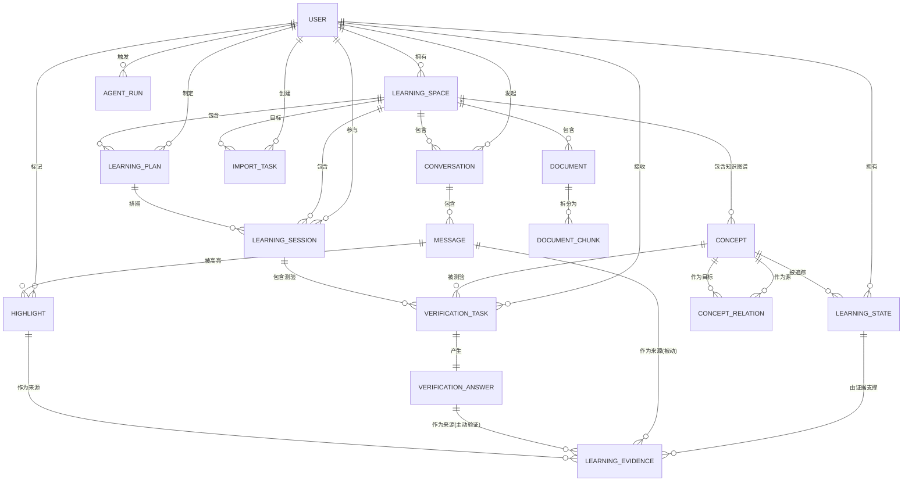

你说得对！上一版我只聚焦在“验证”模块，把 `Learning_Session`、`Learning_Plan`、`Import_Task`、`Agent_Run`、`Highlight` 这些重要实体漏掉了。现在我把**全部 17 张表**一次性补齐，形成一个真正能支撑“主动验证 + 长期学习”的完整闭环。

---

# 一、完整 ER 图（Mermaid）



---

# 二、完整数据模型（按模块分组）

## 模块 1：用户与权限

### 1.1 `user` — 用户表
| 字段            | 类型         | 约束             | 说明        |
| :-------------- | :----------- | :--------------- | :---------- |
| `id`            | Bigint       | PK, Auto         | 用户ID      |
| `username`      | Varchar(50)  | Not Null, Unique | 登录名      |
| `password_hash` | Varchar(255) | Not Null         | bcrypt 加密 |
| `email`         | Varchar(100) | Unique           | 邮箱        |
| `created_at`    | Datetime     | Not Null         | 注册时间    |
| `updated_at`    | Datetime     | Not Null         | 更新时间    |

---

## 模块 2：学习空间（原知识库）

### 2.1 `learning_space` — 学习空间表
| 字段          | 类型         | 约束                | 说明             |
| :------------ | :----------- | :------------------ | :--------------- |
| `id`          | Bigint       | PK, Auto            |                  |
| `user_id`     | Bigint       | FK(`user.id`)       | 所有者           |
| `name`        | Varchar(100) | Not Null            | 如“操作系统内核” |
| `description` | Text         | Nullable            | 空间描述         |
| `visibility`  | Enum         | `PRIVATE`, `SHARED` | 默认 PRIVATE     |
| `created_at`  | Datetime     | Not Null            |                  |
| `updated_at`  | Datetime     | Not Null            |                  |

---

## 模块 3：知识图谱（概念与关系）

### 3.1 `concept` — 知识点表（全局共享）
| 字段                | 类型         | 约束                    | 说明                                        |
| :------------------ | :----------- | :---------------------- | :------------------------------------------ |
| `id`                | Bigint       | PK, Auto                |                                             |
| `learning_space_id` | Bigint       | FK(`learning_space.id`) | 属于哪个空间                                |
| `canonical_name`    | Varchar(255) | Not Null                | 规范名称，如 "Translation_Lookaside_Buffer" |
| `display_name`      | Varchar(100) |                         | 显示名，如 "TLB"                            |
| `description`       | Text         | Nullable                | 概念解释                                    |
| `difficulty_level`  | Int          | 1~5                     | 难度等级                                    |
| `created_at`        | Datetime     | Not Null                |                                             |
| `updated_at`        | Datetime     | Not Null                |                                             |

### 3.2 `concept_relation` — 概念关系表
| 字段                | 类型     | 约束                                                      | 说明       |
| :------------------ | :------- | :-------------------------------------------------------- | :--------- |
| `id`                | Bigint   | PK, Auto                                                  |            |
| `source_concept_id` | Bigint   | FK(`concept.id`)                                          | 源知识点   |
| `target_concept_id` | Bigint   | FK(`concept.id`)                                          | 目标知识点 |
| `relation_type`     | Enum     | `PREREQUISITE_OF`, `RELATED_TO`, `IS_A`, `CONTRASTS_WITH` |            |
| `weight`            | Float    | 0~1                                                       | 关系强度   |
| `created_at`        | Datetime | Not Null                                                  |            |

---

## 模块 4：对话与消息

### 4.1 `conversation` — 对话表
| 字段                | 类型         | 约束                    | 说明              |
| :------------------ | :----------- | :---------------------- | :---------------- |
| `id`                | Bigint       | PK, Auto                |                   |
| `user_id`           | Bigint       | FK(`user.id`)           |                   |
| `learning_space_id` | Bigint       | FK(`learning_space.id`) |                   |
| `title`             | Varchar(200) | Nullable                | AI 自动总结的标题 |
| `status`            | Enum         | `ACTIVE`, `ARCHIVED`    |                   |
| `created_at`        | Datetime     | Not Null                |                   |
| `updated_at`        | Datetime     | Not Null                | 最后消息时间      |

### 4.2 `message` — 消息表
| 字段              | 类型     | 约束                  | 说明            |
| :---------------- | :------- | :-------------------- | :-------------- |
| `id`              | Bigint   | PK, Auto              |                 |
| `conversation_id` | Bigint   | FK(`conversation.id`) |                 |
| `role`            | Enum     | `USER`, `ASSISTANT`   |                 |
| `content`         | Text     | Not Null              | Markdown 格式   |
| `tokens`          | Int      | Nullable              | 粗略 token 计数 |
| `created_at`      | Datetime | Not Null              |                 |

---

## 模块 5：高亮与笔记

### 5.1 `highlight` — 高亮标记表
| 字段            | 类型     | 约束                                        | 说明                 |
| :-------------- | :------- | :------------------------------------------ | :------------------- |
| `id`            | Bigint   | PK, Auto                                    |                      |
| `user_id`       | Bigint   | FK(`user.id`)                               | 冗余，方便快速查询   |
| `message_id`    | Bigint   | FK(`message.id`)                            | 标记在哪个 AI 回复上 |
| `selected_text` | Text     | Not Null                                    | 选中的原文片段       |
| `type`          | Enum     | `IMPORTANT`, `QUESTION`, `MY_UNDERSTANDING` |                      |
| `note`          | Text     | Nullable                                    | 用户写的批注         |
| `created_at`    | Datetime | Not Null                                    |                      |

---

## 模块 6：文档与 RAG

### 6.1 `document` — 文档元数据表
| 字段                | 类型         | 约束                                                         | 说明                     |
| :------------------ | :----------- | :----------------------------------------------------------- | :----------------------- |
| `id`                | Bigint       | PK, Auto                                                     |                          |
| `learning_space_id` | Bigint       | FK(`learning_space.id`)                                      |                          |
| `name`              | Varchar(255) | Not Null                                                     | 文档显示名称             |
| `file_name`         | Varchar(255) | Not Null                                                     | 原始文件名               |
| `storage_uri`       | Varchar(500) | Not Null                                                     | 文件系统路径或 OSS key   |
| `file_type`         | Enum         | `PDF`, `MD`, `TXT`, `DOCX`                                   |                          |
| `size`              | Bigint       |                                                              | 字节数                   |
| `status`            | Enum         | `UPLOADING`, `PARSING`, `CHUNKING`, `INDEXING`, `READY`, `FAILED` |                          |
| `parser_version`    | Varchar(20)  |                                                              | 解析器版本，便于升级重跑 |
| `created_at`        | Datetime     | Not Null                                                     |                          |
| `updated_at`        | Datetime     | Not Null                                                     |                          |

### 6.2 `document_chunk` — 文档切片表
| 字段            | 类型     | 约束              | 说明        |
| :-------------- | :------- | :---------------- | :---------- |
| `id`            | Bigint   | PK, Auto          |             |
| `document_id`   | Bigint   | FK(`document.id`) |             |
| `chunk_index`   | Int      | Not Null          | 切片序号    |
| `content`       | Text     | Not Null          | 切片文本    |
| `page_number`   | Int      | Nullable          | 页码（PDF） |
| `token_count`   | Int      | Nullable          |             |
| `metadata_json` | JSON     | Nullable          | 扩展元数据  |
| `created_at`    | Datetime | Not Null          |             |

> **向量存储（Vector Store）**：单独放在外部（pgvector/Milvus），表中只需存 `vector_id` 或通过 `document_chunk.id` 关联。

---

## 模块 7：学习计划与课程

### 7.1 `learning_plan` — 学习计划表（长期）
| 字段                | 类型         | 约束                            | 说明                      |
| :------------------ | :----------- | :------------------------------ | :------------------------ |
| `id`                | Bigint       | PK, Auto                        |                           |
| `user_id`           | Bigint       | FK(`user.id`)                   |                           |
| `learning_space_id` | Bigint       | FK(`learning_space.id`)         |                           |
| `title`             | Varchar(200) | Not Null                        | 如“7天掌握Kafka Consumer” |
| `description`       | Text         | Nullable                        |                           |
| `goal`              | Text         | Nullable                        | 学习目标描述              |
| `status`            | Enum         | `ACTIVE`, `COMPLETED`, `PAUSED` |                           |
| `created_at`        | Datetime     | Not Null                        |                           |
| `updated_at`        | Datetime     | Not Null                        |                           |

### 7.2 `learning_session` — 学习课程表（短期，一次学习活动）
| 字段                | 类型         | 约束                                                       | 说明                 |
| :------------------ | :----------- | :--------------------------------------------------------- | :------------------- |
| `id`                | Bigint       | PK, Auto                                                   |                      |
| `user_id`           | Bigint       | FK(`user.id`)                                              |                      |
| `learning_space_id` | Bigint       | FK(`learning_space.id`)                                    |                      |
| `learning_plan_id`  | Bigint       | FK(`learning_plan.id`)                                     | Nullable，可独立存在 |
| `title`             | Varchar(200) | Not Null                                                   | 如“TLB 专项复习”     |
| `session_type`      | Enum         | `GUIDED`（系统引导）, `REVIEW`（复习）, `FREE`（自由学习） |                      |
| `status`            | Enum         | `STARTED`, `FINISHED`, `ABANDONED`                         |                      |
| `started_at`        | Datetime     | Not Null                                                   |                      |
| `finished_at`       | Datetime     | Nullable                                                   |                      |
| `created_at`        | Datetime     | Not Null                                                   |                      |

---

## 模块 8：主动验证（你提出的核心亮点）

### 8.1 `verification_task` — 验证任务表（AI 主动提问）
| 字段                  | 类型     | 约束                                                         | 说明                              |
| :-------------------- | :------- | :----------------------------------------------------------- | :-------------------------------- |
| `id`                  | Bigint   | PK, Auto                                                     |                                   |
| `user_id`             | Bigint   | FK(`user.id`)                                                |                                   |
| `concept_id`          | Bigint   | FK(`concept.id`)                                             | 针对哪个知识点                    |
| `learning_session_id` | Bigint   | FK(`learning_session.id`)                                    | Nullable                          |
| `question_type`       | Enum     | `MULTIPLE_CHOICE`, `TRUE_FALSE`, `FILL_BLANK`, `SHORT_ANSWER` |                                   |
| `question_text`       | Text     | Not Null                                                     | 题目内容                          |
| `options`             | JSON     | Nullable                                                     | 选择题时如 `["A. 会", "B. 不会"]` |
| `correct_answer`      | Text     | Not Null                                                     | 标准答案                          |
| `hint`                | Text     | Nullable                                                     | 提示（选填）                      |
| `status`              | Enum     | `PENDING`, `ANSWERED`, `EXPIRED`, `SKIPPED`                  |                                   |
| `created_at`          | Datetime | Not Null                                                     |                                   |
| `expired_at`          | Datetime | Nullable                                                     | 过期时间（如 24 小时后失效）      |

### 8.2 `verification_answer` — 验证回答表
| 字段          | 类型     | 约束                               | 说明                       |
| :------------ | :------- | :--------------------------------- | :------------------------- |
| `id`          | Bigint   | PK, Auto                           |                            |
| `task_id`     | Bigint   | FK(`verification_task.id`), Unique | 一个任务只允许一次有效回答 |
| `user_answer` | Text     | Not Null                           | 用户回答内容               |
| `is_correct`  | Boolean  | Not Null                           | 系统自动比对结果           |
| `answered_at` | Datetime | Not Null                           |                            |

---

## 模块 9：学习状态与证据链（系统核心）

### 9.1 `learning_state` — 学习状态表（用户 × 知识点）
| 字段               | 类型     | 约束                                                         | 说明                                   |
| :----------------- | :------- | :----------------------------------------------------------- | :------------------------------------- |
| `user_id`          | Bigint   | **PK (复合)** , FK(`user.id`)                                |                                        |
| `concept_id`       | Bigint   | **PK (复合)** , FK(`concept.id`)                             |                                        |
| `mastery`          | Float    | Default 0.0                                                  | 掌握度 0~1                             |
| `confidence`       | Float    | Default 0.0                                                  | 系统置信度 0~1（低于 0.65 会触发验证） |
| `stability`        | Float    | Default 0.5                                                  | 稳定性（多次表现一致则升高）           |
| `status`           | Enum     | `NEW`, `EXPLORING`, `VERIFYING`（等待用户回答验证题）, `UNDERSTANDING`, `PRACTICING`, `MASTERED`, `MISCONCEPTION` |                                        |
| `last_evidence_at` | Datetime | Nullable                                                     | 最近一次获得证据的时间                 |
| `next_review_at`   | Datetime | Nullable                                                     | 下次复习时间（由 Review Agent 计算）   |
| `review_priority`  | Int      | Default 0                                                    | 优先级越高越该复习                     |
| `updated_at`       | Datetime | Not Null                                                     |                                        |

### 9.2 `learning_evidence` — 证据链表（可追溯、可解释）
| 字段            | 类型     | 约束                                                         | 说明                                                         |
| :-------------- | :------- | :----------------------------------------------------------- | :----------------------------------------------------------- |
| `id`            | Bigint   | PK, Auto                                                     |                                                              |
| `user_id`       | Bigint   | FK(`user.id`)                                                |                                                              |
| `concept_id`    | Bigint   | FK(`concept.id`)                                             |                                                              |
| `source_type`   | Enum     | `MESSAGE`（聊天）, `HIGHLIGHT`（笔记）, `VERIFICATION`（主动验证）, `IMPORTED`（导入历史） |                                                              |
| `source_id`     | Bigint   |                                                              | 具体来源 ID（message.id / highlight.id / verification_answer.id） |
| `observation`   | Text     | Not Null                                                     | Agent 观察到的内容（如“用户正确解释了 VPN→PPN 映射”）        |
| `correctness`   | Enum     | `CORRECT`, `PARTIALLY_CORRECT`, `INCORRECT`, `UNKNOWN`       |                                                              |
| `weight`        | Float    | Default 0.8                                                  | **权重：普通对话=0.8，主动验证回答=1.2，导入历史=0.6**       |
| `ai_confidence` | Float    | Not Null                                                     | Agent 对这条观察的把握度 0~1                                 |
| `created_at`    | Datetime | Not Null                                                     |                                                              |

---

## 模块 10：导入与可观测性

### 10.1 `import_task` — 导入任务表（异步）
| 字段                | 类型         | 约束                                                         | 说明             |
| :------------------ | :----------- | :----------------------------------------------------------- | :--------------- |
| `id`                | Bigint       | PK, Auto                                                     |                  |
| `user_id`           | Bigint       | FK(`user.id`)                                                |                  |
| `learning_space_id` | Bigint       | FK(`learning_space.id`)                                      | 导入到哪个空间   |
| `file_name`         | Varchar(255) | Not Null                                                     |                  |
| `source_type`       | Enum         | `CHATGPT_JSON`, `GEMINI_JSON`, `CLAUDE_JSON`, `MARKDOWN`, `TXT` |                  |
| `status`            | Enum         | `PENDING`, `PROCESSING`, `SUCCESS`, `FAILED`                 |                  |
| `progress`          | Int          | 0~100                                                        | 进度百分比       |
| `error_message`     | Text         | Nullable                                                     | 失败原因         |
| `total_messages`    | Int          | 0                                                            | 总共解析出多少条 |
| `created_at`        | Datetime     | Not Null                                                     |                  |
| `updated_at`        | Datetime     | Not Null                                                     |                  |

### 10.2 `agent_run` — Agent 执行轨迹表（调试/可观测）
| 字段                  | 类型     | 约束                                                         | 说明             |
| :-------------------- | :------- | :----------------------------------------------------------- | :--------------- |
| `id`                  | Bigint   | PK, Auto                                                     |                  |
| `user_id`             | Bigint   | FK(`user.id`)                                                |                  |
| `conversation_id`     | Bigint   | FK(`conversation.id`)                                        | Nullable         |
| `learning_session_id` | Bigint   | FK(`learning_session.id`)                                    | Nullable         |
| `agent_type`          | Enum     | `TUTOR`, `LEARNING_STATE`, `RAG`, `REVIEW`, `SUPERVISOR`     |                  |
| `status`              | Enum     | `STARTED`, `THINKING`, `TOOL_CALLING`, `FINISHED`, `TIMEOUT`, `ERROR` |                  |
| `input_summary`       | Text     | Nullable                                                     | 输入截断         |
| `output_summary`      | Text     | Nullable                                                     | 输出截断         |
| `duration_ms`         | Int      |                                                              | 耗时毫秒         |
| `error_stack`         | Text     | Nullable                                                     | 异常堆栈（截断） |
| `created_at`          | Datetime | Not Null                                                     |                  |
| `finished_at`         | Datetime | Nullable                                                     |                  |

---

# 三、主动验证的完整功能逻辑（与你设计的完美结合）

现在这张完整 ER 图如何支撑“AI 不确定就主动提问”？流程如下：

```text
用户发了一条消息
        ↓
Tutor Agent 正常回复（存进 Message）
        ↓
【异步触发】Learning State Agent 被唤醒（通过 RabbitMQ）
        ↓
从 Message 中提取初始 Evidence
  source_type = MESSAGE, weight = 0.8, ai_confidence = 0.65
        ↓
更新 Learning_State:
  mastery = 0.52, confidence = 0.55, status = EXPLORING
        ↓
【决策点】confidence < 0.65 AND mastery < 0.8 ?
        ↓ YES
生成 Verification_Task:
  concept_id = TLB
  question_type = TRUE_FALSE
  question_text = "TLB Miss 一定会触发 Page Fault，对吗？"
  correct_answer = "False"
  status = PENDING
        ↓
同时更新 Learning_State.status = VERIFYING（防止重复提问）
        ↓
推送给 Flutter（用户看到一道题）
        ↓
用户回答: "False"
        ↓
存入 Verification_Answer: is_correct = True, answered_at = now
        ↓
生成【高权重证据】:
  source_type = VERIFICATION, weight = 1.2, correctness = CORRECT, ai_confidence = 0.95
        ↓
重新聚合 Learning_State:
  加权平均后 mastery = 0.78, confidence = 0.88, status = UNDERSTANDING
  next_review_at = 3天后
        ↓
闭环结束，用户可以继续学习
```

---

# 四、总结：这版为什么是完整的？

| 模块                                        | 支撑的功能                     |
| :------------------------------------------ | :----------------------------- |
| `user` + `learning_space`                   | 多知识库隔离                   |
| `concept` + `concept_relation`              | 知识图谱，支撑“前置知识推荐”   |
| `conversation` + `message`                  | 常规 AI 聊天                   |
| `highlight`                                 | 用户主动标记重点/疑问/自我解释 |
| `document` + `document_chunk`               | RAG 数据源管理                 |
| `learning_plan` + `learning_session`        | 长期计划 + 单次课程            |
| `verification_task` + `verification_answer` | **你提出的“主动提问”闭环**     |
| `learning_state` + `learning_evidence`      | 可解释的长期学习状态           |
| `import_task`                               | 外部数据导入                   |
| `agent_run`                                 | 全链路可观测，便于调试         |
