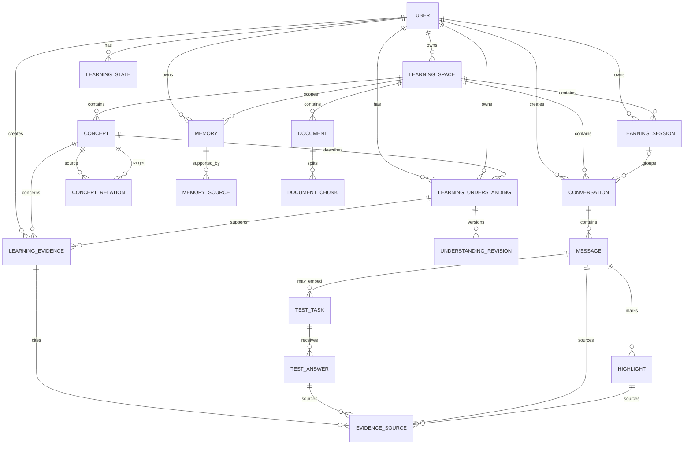

# AI Learning Space — Database & API Design

**Version:** 3.0  
**Status:** Development Baseline

---

# 一、设计目标

本设计优先解决两个真实问题：

1. **跨 Agent Run 的 Evidence 去重必须有数据库兜底**
2. **Memory 必须具备明确 Scope，GLOBAL Memory 不能因为 `learning_space_id = NULL` 而在检索层消失**

同时目标：

> 用尽可能少的接口跑通 `Conversation → Agent → Evidence → Understanding → Memory → Cross-session Retrieval`。

---

# 二、核心 ER



---

# 三、MVP 核心表

MVP 实际开发建议先建：

```text
user
learning_space

learning_session
conversation
message
highlight

concept
concept_relation

learning_understanding
understanding_revision

learning_evidence
evidence_source

memory
memory_source

learning_state

test_task
test_answer

agent_run
```

共 **19 张核心表**。

以下暂时延期：

```text
document
document_chunk
import_task
learning_plan
```

完成 RAG / Import / Plan 阶段再加入。

---

# 四、User

```sql
user (
    id BIGINT PRIMARY KEY,
    username VARCHAR(64) NOT NULL UNIQUE,
    password_hash VARCHAR(255) NOT NULL,
    email VARCHAR(255),
    created_at DATETIME NOT NULL,
    updated_at DATETIME NOT NULL
)
```

---

# 五、Learning Space

```sql
learning_space (
    id BIGINT PRIMARY KEY,
    user_id BIGINT NOT NULL,
    name VARCHAR(128) NOT NULL,
    description TEXT,
    visibility ENUM('PRIVATE','SHARED') NOT NULL DEFAULT 'PRIVATE',
    created_at DATETIME NOT NULL,
    updated_at DATETIME NOT NULL,

    FOREIGN KEY (user_id) REFERENCES user(id),

    INDEX idx_space_user_updated (user_id, updated_at)
)
```

MVP 默认只允许 PRIVATE。

---

# 六、Learning Session

Session 是一段**围绕明确学习目标的活动容器**，不是「用户当前在哪个聊天窗口」。
完整语义与判定规则见 `session-design.md`，这里只落库结构。

```sql
learning_session (
    id BIGINT PRIMARY KEY,
    user_id BIGINT NOT NULL,
    learning_space_id BIGINT NOT NULL,
    title VARCHAR(255),
    goal TEXT,
    current_focus VARCHAR(255),
    status ENUM('ACTIVE','PAUSED','COMPLETED','ABANDONED') NOT NULL,
    started_at DATETIME NOT NULL,
    last_active_at DATETIME NOT NULL,
    completed_at DATETIME,

    FOREIGN KEY (user_id) REFERENCES user(id),
    FOREIGN KEY (learning_space_id) REFERENCES learning_space(id),

    INDEX idx_session_space_active (
        learning_space_id,
        status,
        last_active_at
    )
)
```

`goal` 必须与 `current_focus` 分开：

- `goal` 是**这段活动要解决什么**，创建时由首个命中的 Concept 生成，之后基本不变；
- `current_focus` 是**现在卡在哪**，随对话漂移。

Agent 的上下文里两个都要（见第四十四节 Context Bundle）：只有 `current_focus`
的模型会知道用户卡住了却不知道该把他带到哪；只有 `goal` 的模型会重新讲一遍已经讲过的。
两者都允许为空 —— 空就**不渲染该行**，不要填「未设置」占位。

`PAUSED` 是一档独立状态，不是 `ACTIVE` 的别名：

| 状态        | 含义                                   | 参与 Resolver 候选 |
| ----------- | -------------------------------------- | ------------------ |
| `ACTIVE`    | 正在进行                               | ✅                 |
| `PAUSED`    | 用户主动挂起，之后可能回来             | ✅                 |
| `COMPLETED` | 目标达成                               | ❌                 |
| `ABANDONED` | 用户放弃                               | ❌                 |

`PAUSED` 与 `COMPLETED` 的差别在 Resolver 里才有意义：暂停过的活动仍可被 ATTACH，
已完成的不行，否则用户会莫名其妙被拽回一个自己宣布结束了的 Session。

## 懒创建

`conversation.session_id` **可以为 NULL**，且这是常态而非错误。Session 不在建对话时创建，
而是等用户产生第一条有效学习消息后由 Resolver 决定 ATTACH / CREATE / NONE。

```text
conversation 创建        → session_id = NULL
用户发第一条消息          → 抽出至少一个 Concept？ ── 否 ──→ NONE，session_id 保持 NULL
                                    │
                                   是
                                    ↓
                          Resolver: 有匹配的活动 → ATTACH
                                    没有        → CREATE
```

所以 `session_id` 为 NULL 有两种合法业务含义，都不能当异常处理：

1. 对话刚建出来，用户还没说话（还没到判定时机）；
2. 用户在闲聊，本轮没有任何已知 Concept 被提到（Resolver 判 `NONE`）。

「有效学习消息」在本 MVP 里定义为**首次抽出至少一个 Concept** —— 判据与
「这条消息产不产生 Evidence」完全一致，不另立一套标准。

## 重要变化

不再：

```text
session_conversation
session_test
session_highlight
```

而是：

```text
conversation.session_id
```

直接归属 Session。

Highlight 可以通过：

```text
highlight
 → message
 → conversation
 → session
```

得到所属 Session。

这样少 3 张关联表，也避免大量冗余。

## 六条正式规则

以下六条由 `session-design.md` 最终审查确定，是空间 / 活动 / 对话三者关系的**正式约束**，
不是建议。新增功能时若与之冲突，改功能，不改这六条。

> **1. Space 是长期学习领域。**
> **2. Session 是围绕一个明确学习目标的一段连续学习活动。**
> **3. Conversation 是具体聊天线程，一个 Session 可以包含多个 Conversation。**
> **4. Session 主要负责学习目标、当前焦点、组织多个 Conversation，以及提供短期 Agent 工作上下文。**
> **5. Session 不承载长期 Understanding、Evidence 或 Memory。**
> **6. Session 采用懒创建：Conversation 创建时可以 `session_id = NULL`，用户产生第一条有效学习消息后，由 Session Resolver 决定加入现有 Session 或创建新 Session。**

第 5 条是最容易被违反、也最难在事后纠正的一条。它的含义是：**Session 结束不等于认知消失**。
用户在某个 Session 里形成的 Understanding、攒下的 Evidence、收敛出的 Memory 全部留在
Space 与 Concept 上，换一个 Session 依然能被检索到。所以：

```text
Session   ── 短期：这段时间在解决什么        ── 可以结束、可以暂停、可以放弃
Understanding / Evidence / Memory ── 长期：这个人现在怎么理解 ── 不随 Session 结束而消失
```

Session 的 `goal` / `current_focus` 只是**给 Agent 的短期工作上下文**（第 4 条），
不是学习成果本身。把「这次学到哪」写进 Session、把「他到底懂不懂」留在 Understanding 上，
两者不要混。

第 6 条的 Resolver 输入契约与优先级规则见 `session-design.md` §五，落地实现是
`backend/.../model/SessionResolver.java`（纯函数，脱离 Spring 可单测）。

---

# 七、Conversation

```sql
conversation (
    id BIGINT PRIMARY KEY,
    user_id BIGINT NOT NULL,
    learning_space_id BIGINT NOT NULL,
    session_id BIGINT,
    title VARCHAR(255),
    status ENUM('ACTIVE','ARCHIVED') NOT NULL,
    last_message_at DATETIME,
    last_message_seq INT NOT NULL DEFAULT 0,
    created_at DATETIME NOT NULL,
    updated_at DATETIME NOT NULL,

    FOREIGN KEY (user_id) REFERENCES user(id),
    FOREIGN KEY (learning_space_id) REFERENCES learning_space(id),
    FOREIGN KEY (session_id) REFERENCES learning_session(id),

    INDEX idx_conv_space_updated (
        learning_space_id,
        updated_at
    ),

    INDEX idx_conv_session (
        session_id,
        updated_at
    )
)
```

`last_message_seq` 是消息序号的分配计数器，0 表示尚未分配。写入时先在同一事务里
`UPDATE conversation SET last_message_seq = last_message_seq + 1`，再读回。
不用 `SELECT MAX(sequence_no) ... FOR UPDATE`：那会在
`message(conversation_id, sequence_no)` 索引上加范围锁 / 间隙锁，并发写入不同对话时
会互相等待并死锁。已有库升级见 `schema-migration-phase54-message-seq.sql`。

---

# 八、Message

```sql
message (
    id BIGINT PRIMARY KEY,
    conversation_id BIGINT NOT NULL,
    role ENUM('USER','ASSISTANT','SYSTEM','TOOL') NOT NULL,
    message_type ENUM('TEXT','TEST','EVENT') NOT NULL DEFAULT 'TEXT',
    sequence_no INT NOT NULL,
    content LONGTEXT NOT NULL,
    tokens INT,
    created_at DATETIME NOT NULL,

    FOREIGN KEY (conversation_id) REFERENCES conversation(id),

    UNIQUE KEY uk_message_sequence (
        conversation_id,
        sequence_no
    )
)
```

---

# 九、Highlight

```sql
highlight (
    id BIGINT PRIMARY KEY,
    user_id BIGINT NOT NULL,
    message_id BIGINT NOT NULL,
    selected_text TEXT NOT NULL,
    start_offset INT NOT NULL,
    end_offset INT NOT NULL,
    mark_type ENUM(
        'IMPORTANT',
        'QUESTION',
        'MY_UNDERSTANDING',
        'MISCONCEPTION_CANDIDATE',
        'CONCEPT_LINK'
    ) NOT NULL,
    note TEXT,
    created_at DATETIME NOT NULL,

    FOREIGN KEY (user_id) REFERENCES user(id),
    FOREIGN KEY (message_id) REFERENCES message(id),

    INDEX idx_highlight_message (message_id),
    INDEX idx_highlight_user_type (user_id, mark_type, created_at)
)
```

---

# 十、Concept

```sql
concept (
    id BIGINT PRIMARY KEY,
    learning_space_id BIGINT NOT NULL,
    canonical_name VARCHAR(255) NOT NULL,
    display_name VARCHAR(255) NOT NULL,
    description TEXT,
    difficulty_level INT,
    created_at DATETIME NOT NULL,
    updated_at DATETIME NOT NULL,

    FOREIGN KEY (learning_space_id)
        REFERENCES learning_space(id),

    UNIQUE KEY uk_concept_space_name (
        learning_space_id,
        canonical_name
    )
)
```

---

# 十一、Concept Relation

```sql
concept_relation (
    id BIGINT PRIMARY KEY,
    source_concept_id BIGINT NOT NULL,
    target_concept_id BIGINT NOT NULL,
    relation_type ENUM(
        'PREREQUISITE',
        'RELATED',
        'PART_OF',
        'CONTRAST'
    ) NOT NULL,
    weight FLOAT,
    created_at DATETIME NOT NULL,

    FOREIGN KEY (source_concept_id)
        REFERENCES concept(id),

    FOREIGN KEY (target_concept_id)
        REFERENCES concept(id),

    UNIQUE KEY uk_concept_relation (
        source_concept_id,
        target_concept_id,
        relation_type
    )
)
```

---

# 十二、Learning Understanding

它保存当前 Snapshot。

```sql
learning_understanding (
    id BIGINT PRIMARY KEY,
    user_id BIGINT NOT NULL,
    concept_id BIGINT NOT NULL,

    summary TEXT,
    known_parts JSON,
    misconceptions JSON,
    uncertain_parts JSON,
    latest_user_explanation TEXT,

    status ENUM(
        'UNKNOWN',
        'EXPOSED',
        'PARTIAL',
        'DEMONSTRATED',
        'MISCONCEPTION'
    ) NOT NULL DEFAULT 'UNKNOWN',

    version INT NOT NULL DEFAULT 0,
    current_revision_id BIGINT,

    created_at DATETIME NOT NULL,
    updated_at DATETIME NOT NULL,

    FOREIGN KEY (user_id) REFERENCES user(id),
    FOREIGN KEY (concept_id) REFERENCES concept(id),

    UNIQUE KEY uk_understanding_user_concept (
        user_id,
        concept_id
    )
)
```

## version

用于乐观锁。

避免：

```text
Agent A
Agent B
```

同时覆盖 Understanding。

---

# 十三、Understanding Revision

```sql
understanding_revision (
    id BIGINT PRIMARY KEY,
    understanding_id BIGINT NOT NULL,
    revision_no INT NOT NULL,

    summary TEXT,
    known_parts JSON,
    misconceptions JSON,
    uncertain_parts JSON,
    user_explanation TEXT,

    status ENUM(
        'UNKNOWN',
        'EXPOSED',
        'PARTIAL',
        'DEMONSTRATED',
        'MISCONCEPTION'
    ) NOT NULL,

    trigger_evidence_id BIGINT,

    created_at DATETIME NOT NULL,

    FOREIGN KEY (understanding_id)
        REFERENCES learning_understanding(id),

    FOREIGN KEY (trigger_evidence_id)
        REFERENCES learning_evidence(id),

    UNIQUE KEY uk_understanding_revision (
        understanding_id,
        revision_no
    )
)
```

Revision 是 append-only。

不要 UPDATE 历史 Revision。

---

# 十四、Learning Evidence

这是本次最重要的改动之一。

```sql
learning_evidence (
    id BIGINT PRIMARY KEY,

    user_id BIGINT NOT NULL,
    concept_id BIGINT NOT NULL,
    understanding_id BIGINT,

    evidence_type ENUM(
        'USER_EXPLANATION',
        'OBSERVATION',
        'TEST_RESULT',
        'USER_CORRECTION',
        'HIGHLIGHT_SIGNAL'
    ) NOT NULL,

    observation TEXT NOT NULL,

    correctness ENUM(
        'CORRECT',
        'PARTIAL',
        'INCORRECT',
        'UNKNOWN'
    ) NOT NULL,

    reasoning_quality DECIMAL(5,4),
    specificity DECIMAL(5,4),
    ai_confidence DECIMAL(5,4),

    dedupe_key CHAR(64) NOT NULL,

    first_seen_run_id BIGINT,
    last_seen_run_id BIGINT,

    created_at DATETIME NOT NULL,
    updated_at DATETIME NOT NULL,

    FOREIGN KEY (user_id) REFERENCES user(id),
    FOREIGN KEY (concept_id) REFERENCES concept(id),
    FOREIGN KEY (understanding_id)
        REFERENCES learning_understanding(id),

    UNIQUE KEY uk_evidence_dedupe (
        dedupe_key
    ),

    INDEX idx_evidence_concept_created (
        user_id,
        concept_id,
        created_at
    )
)
```

---

# 十五、Evidence 去重规则

`dedupe_key` 必须由应用层确定性计算。

推荐：

```text
SHA256(
    user_id
    + concept_id
    + evidence_type
    + primary_source_type
    + primary_source_id
    + normalize(observation)
)
```

例如：

```text
Run #101
Message #100
Observation:
“用户知道 TLB 是页表缓存”

→ dedupe_key = abc123...
```

Run #102 再分析同一个 Message：

```text
same observation
same source
same concept
        ↓
same dedupe_key
        ↓
UNIQUE constraint
        ↓
不产生第二条逻辑 Evidence
```

---

# 十六、为什么不使用 agent_run_id 做去重

错误设计：

```text
UNIQUE(run_id, source_id)
```

因为：

```text
Run A ≠ Run B
```

数据库会认为：

```text
Evidence A
Evidence B
```

都是合法的新数据。

所以：

> **Run 是执行记录，不是 Evidence 身份。**

Evidence 的身份必须由其业务语义决定。

---

# 十七、Evidence Source

一个 Evidence 可以有多个来源。

```sql
evidence_source (
    id BIGINT PRIMARY KEY,

    evidence_id BIGINT NOT NULL,

    source_type ENUM(
        'MESSAGE',
        'HIGHLIGHT',
        'TEST_ANSWER'
    ) NOT NULL,

    source_id BIGINT NOT NULL,

    created_at DATETIME NOT NULL,

    FOREIGN KEY (evidence_id)
        REFERENCES learning_evidence(id),

    UNIQUE KEY uk_evidence_source (
        evidence_id,
        source_type,
        source_id
    )
)
```

由于 `source_id` 可以指向不同表，这是 polymorphic reference。

数据库无法建立真正的 FK 到三个不同表。

因此：

```text
Application Layer
负责 source existence 校验

Database
负责 evidence-source pair 去重
```

---

# 十八、Memory

本次第二个重点改动：

> **Memory 必须显式声明 Scope。**

```sql
memory (
    id BIGINT PRIMARY KEY,

    user_id BIGINT NOT NULL,

    scope_type ENUM(
        'GLOBAL',
        'SPACE',
        'CONCEPT'
    ) NOT NULL,

    learning_space_id BIGINT,
    concept_id BIGINT,

    memory_type ENUM(
        'USER',
        'LEARNING',
        'PREFERENCE'
    ) NOT NULL,

    scope_key VARCHAR(128) NOT NULL,

    memory_key VARCHAR(128) NOT NULL,

    content TEXT NOT NULL,

    status ENUM(
        'CANDIDATE',
        'ACTIVE',
        'ARCHIVED'
    ) NOT NULL DEFAULT 'CANDIDATE',

    importance DECIMAL(5,4),

    version INT NOT NULL DEFAULT 0,

    embedding_ref VARCHAR(255),

    created_at DATETIME NOT NULL,
    updated_at DATETIME NOT NULL,

    FOREIGN KEY (user_id) REFERENCES user(id),

    FOREIGN KEY (learning_space_id)
        REFERENCES learning_space(id),

    FOREIGN KEY (concept_id)
        REFERENCES concept(id),

    UNIQUE KEY uk_memory_identity (
        user_id,
        scope_key,
        memory_key
    ),

    INDEX idx_memory_retrieval (
        user_id,
        scope_type,
        learning_space_id,
        concept_id,
        status
    )
)
```

---

# 十九、为什么增加 scope_key

MySQL 的 UNIQUE + NULL 有一个常见坑：

```text
(user_id, scope_type, NULL, NULL, memory_key)
```

多个 NULL 可能允许多行。

因此不能依赖：

```text
UNIQUE(user_id, scope_type, learning_space_id, concept_id, memory_key)
```

保证 GLOBAL Memory 的唯一性。

改为：

```text
scope_key
```

例如：

```text
GLOBAL
SPACE:12
CONCEPT:31
```

然后：

```text
UNIQUE(
    user_id,
    scope_key,
    memory_key
)
```

这样数据库能够真正兜底。

---

# 二十、Memory Scope 规则

## GLOBAL

```text
scope_type = GLOBAL
scope_key = GLOBAL
learning_space_id = NULL
concept_id = NULL
```

检索：

```text
任意 Space
```

---

## SPACE

```text
scope_type = SPACE
scope_key = SPACE:{space_id}
learning_space_id = {space_id}
concept_id = NULL
```

只在该 Space 可见。

---

## CONCEPT

```text
scope_type = CONCEPT
scope_key = CONCEPT:{concept_id}
learning_space_id = {space_id}
concept_id = {concept_id}
```

只在：

```text
当前 Space
+
当前 Concept
```

可见。

---

# 二十一、Memory 的检索 SQL 逻辑

当前：

```text
user_id = ?
space_id = ?
concept_id = ?
```

检索：

```sql
WHERE user_id = :userId
  AND status = 'ACTIVE'
  AND (
       scope_type = 'GLOBAL'
       OR (
           scope_type = 'SPACE'
           AND learning_space_id = :spaceId
       )
       OR (
           scope_type = 'CONCEPT'
           AND learning_space_id = :spaceId
           AND concept_id = :conceptId
       )
  )
```

这样 GLOBAL Memory 不会再因为：

```text
learning_space_id IS NULL
```

被漏掉。

---

# 二十二、Memory Source

```sql
memory_source (
    id BIGINT PRIMARY KEY,

    memory_id BIGINT NOT NULL,

    source_type ENUM(
        'MESSAGE',
        'HIGHLIGHT',
        'EVIDENCE',
        'TEST_ANSWER'
    ) NOT NULL,

    source_id BIGINT NOT NULL,

    created_at DATETIME NOT NULL,

    FOREIGN KEY (memory_id)
        REFERENCES memory(id),

    UNIQUE KEY uk_memory_source (
        memory_id,
        source_type,
        source_id
    )
)
```

---

# 二十三、Learning State

只保存轻量、UI 友好的状态。

```sql
learning_state (
    user_id BIGINT NOT NULL,
    concept_id BIGINT NOT NULL,

    status ENUM(
        'UNKNOWN',
        'EXPOSED',
        'PARTIAL',
        'DEMONSTRATED',
        'MISCONCEPTION'
    ) NOT NULL,

    next_review_at DATETIME,
    review_priority INT,

    last_evidence_at DATETIME,
    updated_at DATETIME NOT NULL,

    PRIMARY KEY (
        user_id,
        concept_id
    ),

    FOREIGN KEY (user_id)
        REFERENCES user(id),

    FOREIGN KEY (concept_id)
        REFERENCES concept(id)
)
```

---

# 二十四、为什么 Learning State 仍然保留

虽然 Understanding 是核心，但状态页需要快速查询：

```text
需要留意的地方
下一次复习
优先级
```

因此保留一个轻量 projection。

它不是认知真相。

真正详细状态：

```text
Learning Understanding
```

---

# 二十五、Test Task

```sql
test_task (
    id BIGINT PRIMARY KEY,

    user_id BIGINT NOT NULL,
    concept_id BIGINT NOT NULL,
    conversation_id BIGINT NOT NULL,

    question_type ENUM(
        'SINGLE_CHOICE',
        'TRUE_FALSE',
        'SHORT_ANSWER'
    ) NOT NULL,

    question_text TEXT NOT NULL,
    options JSON,
    correct_answer TEXT,
    evaluation_rubric JSON,

    status ENUM(
        'PENDING',
        'ANSWERED',
        'EXPIRED'
    ) NOT NULL,

    created_at DATETIME NOT NULL,
    expired_at DATETIME,

    FOREIGN KEY (user_id)
        REFERENCES user(id),

    FOREIGN KEY (concept_id)
        REFERENCES concept(id),

    FOREIGN KEY (conversation_id)
        REFERENCES conversation(id)
)
```

---

# 二十六、Test Answer

```sql
test_answer (
    id BIGINT PRIMARY KEY,

    task_id BIGINT NOT NULL,

    user_answer TEXT NOT NULL,

    is_correct BOOLEAN,

    evaluation JSON,

    answered_at DATETIME NOT NULL,

    FOREIGN KEY (task_id)
        REFERENCES test_task(id),

    UNIQUE KEY uk_test_answer_task (
        task_id
    )
)
```

MVP 默认每个 Test 只允许一次提交。

---

# 二十七、Agent Run

```sql
agent_run (
    id BIGINT PRIMARY KEY,

    user_id BIGINT NOT NULL,
    conversation_id BIGINT,

    run_type ENUM(
        'CHAT',
        'ANALYSIS',
        'TEST',
        'MEMORY'
    ) NOT NULL,

    status ENUM(
        'RUNNING',
        'COMPLETED',
        'FAILED'
    ) NOT NULL,

    trace_id CHAR(32),

    input_summary TEXT,
    output_summary TEXT,

    duration_ms INT,
    error_message TEXT,

    created_at DATETIME NOT NULL,
    finished_at DATETIME,

    FOREIGN KEY (user_id)
        REFERENCES user(id),

    FOREIGN KEY (conversation_id)
        REFERENCES conversation(id),

    INDEX idx_agent_run_trace (trace_id),
    INDEX idx_agent_run_conversation (
        conversation_id,
        created_at
    )
)
```

注意：

```text
agent_run
```

用于追踪执行。

**不要把它当业务实体去参与 Evidence 去重。**

---

# 二十八、Understanding 更新事务

当 Agent 分析产生新 Evidence：

```text
BEGIN

1. UPSERT Evidence
2. INSERT EvidenceSource
3. SELECT Understanding FOR UPDATE
4. 生成新 Revision
5. UPDATE Understanding
6. UPDATE LearningState

COMMIT
```

如果多个 Worker 同时更新同一 Concept：

```text
version / SELECT FOR UPDATE
```

保证不会出现 Revision 冲突。

---

# 二十九、Evidence Upsert

伪 SQL：

```sql
INSERT INTO learning_evidence (...)
VALUES (...)
ON DUPLICATE KEY UPDATE
    last_seen_run_id = VALUES(last_seen_run_id),
    updated_at = NOW();
```

然后：

```sql
INSERT INTO evidence_source (...)
VALUES (...)
ON DUPLICATE KEY UPDATE
    id = id;
```

这样：

```text
重复 Run
```

不会制造重复 Evidence，但可能补充新的 Evidence Source。

---

# 三十、Memory Upsert

Memory 根据：

```text
user_id
scope_key
memory_key
```

定位。

流程：

```text
Candidate
 ↓
找同 key Memory
 ↓
不存在 → INSERT
存在
 ↓
Reconcile
 ├─ IGNORE
 ├─ UPDATE
 └─ ARCHIVE
```

Memory UPDATE 必须：

```text
version + optimistic lock
```

---

# 三十一、公共 API：11 个

## 1. Register

```http
POST /api/auth/register
```

---

## 2. Login

```http
POST /api/auth/login
```

---

## 3. List Spaces

```http
GET /api/spaces
```

---

## 4. Create Space

```http
POST /api/spaces
```

Body:

```json
{
  "name": "操作系统",
  "description": "OS 学习"
}
```

---

## 5. Create Conversation

```http
POST /api/spaces/{spaceId}/conversations
```

Body:

```json
{
  "title": "TLB 与 Page Fault"
}
```

**服务器不在这里创建或绑定 Learning Session。**

这是最容易写反的一处 —— 建对话时**响应里的 `sessionId` 就是 `null`**，不要顺手补一个
「默认 Session」，也不要因为 `null` 看起来像缺字段就去补空值。

Session 的归属在**用户发第一条有效消息时**才由 Resolver 决定（`session-design.md` §五）：

```text
POST /api/spaces/{spaceId}/conversations   → conversation.session_id = NULL（返回 sessionId: null）
POST /api/conversations/{id}/messages      → 抽出至少一个 Concept？不 → 仍为 NULL（NONE）
                                                              是 → ATTACH 现有 / CREATE 新的
```

为什么不做成「建对话即建 Session」：一个 Session 可以包含多个 Conversation（第六节规则 3），
而用户建对话时还不知道自己要问什么。提前建出来的 Session 会是空壳，`goal` 也没法填 ——
它由首个命中的 Concept 生成。所以顺序只能是「先有内容，再有归属」。

---

## 6. Get Messages

```http
GET /api/conversations/{conversationId}/messages
```

---

## 7. Send Message / SSE

```http
POST /api/conversations/{conversationId}/messages
```

Body:

```json
{
  "content": "TLB Miss 和 Page Fault 有什么关系？"
}
```

Response:

```text
text/event-stream
```

Events:

```text
message.start
message.delta
message.delta
message.end
```

---

## 8. Create Highlight

```http
POST /api/messages/{messageId}/highlights
```

Body:

```json
{
  "selectedText": "TLB 是 Page Table 的缓存",
  "startOffset": 12,
  "endOffset": 29,
  "markType": "MY_UNDERSTANDING",
  "note": "这是我的理解"
}
```

创建 Highlight 后：

```text
Spring Boot
 ↓
触发 Analysis
```

---

## 9. Learning Overview

一个接口解决状态首页最主要的数据。

```http
GET /api/spaces/{spaceId}/learning-overview
```

返回：

```json
{
  "topicCoverage": [],
  "attention": [],
  "recentActivity": []
}
```

不要拆成：

```text
/topic-coverage
/attention
/activities
```

MVP 没有必要把一个页面拆成 3 个请求。

---

## 10. Understanding Detail

```http
GET /api/spaces/{spaceId}/concepts/{conceptId}/learning
```

返回：

```json
{
  "concept": {},
  "understanding": {},
  "recentRevisions": [],
  "evidence": []
}
```

这样：

```text
Understanding
+
Evidence Chain
```

一个请求解决。

---

## 11. Submit Test Answer

```http
POST /api/test-tasks/{taskId}/answer
```

Body:

```json
{
  "answer": "..."
}
```

流程：

```text
Answer
 ↓
Evaluate
 ↓
Evidence
 ↓
Understanding
 ↓
Learning State
```

---

# 三十二、Agent Internal API：2 个

这是为了满足：

> 最少接口数跑完整个 Agent 流程。

---

> **本节与下一节是设计意图，不是当前实现的契约。** 真正落地的字段清单见
> `agent/README.md` 第六节与 `backend/.../dto/agent/`，
> 两边字段逐个同名、零映射。差异今天就能看出来：实际路径是 `POST /agent/chat` /
> `POST /agent/analyze`（不是 `/internal/agent/*`）、`spaceId` 实际叫 `learningSpaceId`、
> Chat 没有 `messageId`（Analyze 有，用于挂 Evidence 来源）、
> `context` 不由后端组装（后端只发 `session` + 历史，检索在 Python 侧做）。
> Analyze 已实现：请求见后端 `AnalyzeAgentRequest`，响应在 Python 侧是
> `AnalyzeResult`、后端对应 `AnalyzeAgentResult`
> （`evidenceCandidates / understandingProposal / memoryCandidates /
> verificationDecision / analyzerVersion`）；后端在 `AgentAnalysisWriteService`
> 里完成去重与写入，失败时退回 `rules-v1`。Analyze 的检索**不允许降级到 Fixture**
> （`allow_degradation=False`），顶层没有任何分析字段的 JSON 也会被判为失败 ——
> 两者都是为了不让样例数据或空结果静默写进用户的理解。

## Agent API 1：Chat

```http
POST /internal/agent/chat
```

Request：

```json
{
  "userId": 1,
  "spaceId": 10,
  "conversationId": 100,
  "messageId": 1001,

  "currentMessage": "...",

  "context": {
    "recentMessages": [],
    "understandings": [],
    "memories": [],
    "knowledge": []
  }
}
```

Response：

```text
text/event-stream
```

Agent 只负责：

```text
Context interpretation
Tutor
```

Backend 负责：

```text
Message persistence
```

---

# 三十三、Agent API 2：Analyze

```http
POST /internal/agent/analyze
```

Request：

```json
{
  "runId": 2001,
  "userId": 1,
  "spaceId": 10,
  "conversationId": 100,
  "messageId": 1001,

  "context": {
    "understanding": [],
    "recentEvidence": []
  }
}
```

Response：

```json
{
  "evidenceCandidates": [],
  "understandingProposal": {},
  "memoryCandidates": [],
  "verificationDecision": {
    "action": "SKIP"
  }
}
```

注意：

> Python Agent 不直接写 MySQL。

Spring Boot 收到结果后：

```text
Evidence Upsert
Understanding Revision
Memory Reconcile
Learning State
```

全部由 Backend 执行。

---

# 三十四、为什么 Agent API 只保留 2 个

不要一开始暴露：

```text
/retrieve-memory
/create-evidence
/update-understanding
/create-revision
/update-state
/create-test
```

一堆 HTTP API。

这会导致：

```text
Agent
 ↕
Backend
 ↕
Agent
 ↕
Backend
```

大量来回。

MVP：

```text
Spring Boot
   ↓ context bundle
Python Agent
   ↓ result bundle
Spring Boot
   ↓ transaction
MySQL
```

非常清楚。

---

# 三十五、Backend → Agent 的 Context Bundle

Backend 从数据库读取：

```text
recent_messages
relevant_understanding
relevant_memory
relevant_evidence
relevant_concepts
relevant_knowledge
current_session                 ← 本阶段学习活动（goal / current_focus）
```

然后一次性发送给 Agent。

`current_session` 是其中**唯一不带 `relevant_` 前缀的一项**，因为它不做检索、不做相关性排序：
它就是这条 Conversation 当前归属的那个 Session，取 `conversation.session_id` 一行而已。

```json
{
  "session": {
    "id": 20,
    "title": "虚拟内存地址转换",
    "goal": "理解 VA → TLB → Page Table → PA",
    "currentFocus": "卡在 TLB Miss 与 Page Fault 的关系"
  }
}
```

它对应第六节规则 4 的「短期 Agent 工作上下文」。两点约定：

- **`session` 为 `null` 是常态**，不要填占位对象。两种合法情况：对话还没归属，
  或用户在闲聊（Resolver 判 `NONE`）。Agent 侧遇到 `null` 就**整块不渲染** ——
  编一个「未设置」会让模型以为自己知道什么。
- `goal` 与 `current_focus` **都要给**，理由见第六节：一个回答「要解决什么」，
  一个回答「现在卡在哪」，缺哪个模型都会讲偏。

未来要把复杂 Retrieval 放到 Python 时，可以再增加内部 Context Query API。

第一版没必要。

---

# 三十六、完整链路

```text
Flutter
   ↓
POST /messages
   ↓
Spring Boot
   ↓
保存 User Message
   ↓
Session Resolver                 ← 必须在组装 Context 之前
   ↓
组装 Context（含 current_session）
   ↓
POST /internal/agent/chat
   ↓
Python Tutor
   ↓
SSE
   ↓
Spring Boot
   ↓
保存 Assistant Message
   ↓
Flutter
```

**Resolver 的位置是硬要求，不能挪到答复生成之后。** 最需要继承上一个 Session 目标的那一轮，
恰恰是「新建对话接着学同一个知识点」——而此刻 `conversation.session_id` 还是 NULL。
把它放在生成之后，这一轮就什么都带不上，等下一轮才补上，用户看到的第一条回答已经跑偏了。
另外 `agent_run.session_id` 也依赖它：先解析，这一行轨迹在 INSERT 时就写对归属，
而不是事后补一次 UPDATE（中间那段时间里这行的归属是错的）。

---
随后：

```text
Spring Boot
   ↓
POST /internal/agent/analyze
   ↓
Python Analysis
   ↓
Evidence Candidates
Understanding Proposal
Memory Candidates
Verification Decision
   ↓
Spring Boot Transaction
   ├── Evidence Upsert
   ├── Evidence Source
   ├── Understanding Revision
   ├── Learning State
   └── Memory Reconcile
```

---

# 三十七、跨 Run Evidence 去重完整流程

```text
Message #100
     ↓
Run #1
     ↓
Evidence Candidate
     ↓
dedupe_key = X
     ↓
DB INSERT
     ↓
Evidence #50
```

再次：

```text
Message #100
     ↓
Run #2
     ↓
Evidence Candidate
     ↓
dedupe_key = X
     ↓
DB UNIQUE
     ↓
已有 Evidence #50
     ↓
只更新 last_seen_run
```

因此：

```text
Agent 是否记得去重
```

不再是可靠性的来源。

真正兜底：

```text
DATABASE UNIQUE
```

---

# 三十八、Memory 可见性完整流程

当前用户：

```text
user = 1
space = OS
concept = TLB
```

Memory：

```text
M1 GLOBAL
scope_key = GLOBAL

M2 SPACE
scope_key = SPACE:10

M3 CONCEPT
scope_key = CONCEPT:31
```

Context Retrieval：

```text
GLOBAL M1 ✅
OS M2 ✅
TLB M3 ✅

Redis Space-A Memory ❌
Other User Memory ❌
Other Space Memory ❌
```

---

# 三十九、为什么不把所有 Memory 都做成 Vector Search

Vector Search 只解决：

> “语义上像不像。”

不能保证：

> “这个用户有权看到吗？”

因此必须：

```text
Permission / Scope Filter
        ↓
Semantic Retrieval
        ↓
Top K
```

而不是：

```text
Vector Search
↓
直接返回
```

---

# 四十、Memory Retrieval 建议

第一版：

```text
1. Scope Filter
2. Exact Concept Filter
3. Keyword / Metadata Filter
4. Vector Search
5. Top-K
```

优先级：

```text
CONCEPT
>
SPACE
>
GLOBAL
```

但 GLOBAL 仍然必须进入候选集合。

---

# 四十一、理解更新规则

### 无变化

```text
Evidence
 ↓
No Change
```

不产生 Revision。

### 有变化

```text
Evidence
 ↓
New Revision
 ↓
Update Snapshot
```

### 冲突

```text
Old Evidence
+
New Evidence
 ↓
Conflict
 ↓
保持旧 Evidence
 ↓
New Revision
```

---

# 四十二、重要状态规则

## 当前用户输入优先于历史 Memory

```text
Current Input
>
Historical Memory
```

但不自动删除 Memory。

---

## Memory 删除不影响 Evidence

```text
Delete Memory
≠
Delete Evidence
```

---

## Understanding 更新不删除 Revision

```text
Update Understanding
≠
Update Old Revision
```

---

# 四十三、数据库事务边界

## Chat Transaction

```text
保存 User Message
```

结束。

AI 流式回复完成后：

```text
保存 Assistant Message
```

---

## Learning Analysis Transaction

```text
Evidence Upsert
+
Evidence Source Upsert
+
Understanding Revision
+
Understanding Snapshot
+
Learning State
+
Memory Reconcile
```

一次事务。

如果失败：

```text
全部 rollback
```

避免：

```text
Evidence 已写
Understanding 没写
State 已更新
Memory 没更新
```

这种半完成状态。

---

# 四十四、数据库索引

最重要的索引：

```text
conversation:
(user_id, learning_space_id, updated_at)
(session_id, updated_at)                ← idx_conv_session，Session 组织对话要用

learning_session:
(learning_space_id, status, last_active_at)   ← idx_session_space_active，Resolver 取候选要用

message:
(conversation_id, sequence_no)

highlight:
(message_id)
(user_id, mark_type, created_at)

understanding:
(user_id, concept_id)

evidence:
UNIQUE(dedupe_key)
(user_id, concept_id, created_at)

memory:
UNIQUE(user_id, scope_key, memory_key)
(user_id, scope_type, learning_space_id, concept_id, status)

revision:
(understanding_id, revision_no)

agent_run:
(trace_id)
(conversation_id, created_at)
```

前两条不是「顺手加的」：`idx_session_space_active` 是 Resolver 每次发消息都要跑的
候选查询（本 user + 本 space + status ∈ (ACTIVE, PAUSED) 按 `last_active_at` 倒序）的唯一支撑；
`idx_conv_session` 是「列出这个 Session 下的所有对话」的唯一支撑。少任何一条，
Session 这两个最热的操作都会退化成全表扫。

`agent_run.trace_id` 的用途要单独说：它是**两跳链路里唯一能跨进程把日志对上的键**。
后端的 `agent_run.id` 与 Agent 进程内的 `run_id` 是两套自增，互不相干 ——
排查「这一轮到底检索到了什么」时，只有 trace_id 能把 `agent_run` 那行和 `agent.log` 那行接起来。

---

# 四十五、第一阶段开发顺序

## M1

建表：

```text
user
learning_space
learning_session
conversation
message
highlight
```

完成：

```text
Login
Space
Conversation
Chat
```

---

## M2

建：

```text
concept
learning_understanding
learning_state
learning_evidence
evidence_source
```

完成：

```text
User Message
→ Evidence
→ Understanding
```

---

## M3

建：

```text
understanding_revision
memory
memory_source
```

完成：

```text
Understanding
→ Revision
→ Memory
```

---

## M4

做：

```text
Cross-session Retrieval
```

验收：

```text
Conversation A
↓
Understanding
↓
Conversation B
↓
召回
↓
个性化回答
```

---

## M5

加入：

```text
Test
Verification
```

---

# 四十六、第一阶段不要创建的表

暂时不建：

```text
import_task
learning_plan
document
document_chunk
```

也暂时不做：

```text
复杂 MQ
复杂 Vector DB
复杂 Knowledge Graph
```

先让：

```text
Conversation
Evidence
Understanding
Memory
```

成立。

---

# 四十七、最终核心数据关系

```text
                  USER
                   │
          ┌────────┼────────┐
          ↓        ↓        ↓
        SPACE    MEMORY   STATE
          │
          ↓
       SESSION
          │
          ↓
    CONVERSATION
          │
          ↓
       MESSAGE
          │
          ↓
      HIGHLIGHT
          │
          └─────────┐
                    ↓
                 EVIDENCE
                    │
           ┌────────┴────────┐
           ↓                 ↓
     UNDERSTANDING       SOURCE
           │
           ↓
       REVISION
           │
           ↓
       LEARNING STATE
```

Test：

```text
Conversation
   ↓
TestTask
   ↓
TestAnswer
   ↓
Evidence
```

Memory：

```text
Evidence / Message / Highlight
          ↓
       Memory
          ↓
       Future Context
```

---

# 四十八、最终原则

### Evidence

```text
身份：
dedupe_key
```

### Memory

```text
可见性：
scope_key
```

### Understanding

```text
当前：
snapshot

历史：
revision
```

### Session

```text
定位：
短期活动容器

归属：
懒创建（session_id 可为 NULL）
Resolver 决定 ATTACH / CREATE / NONE

承载：
goal / current_focus / 组织多个 Conversation

不承载：
Understanding / Evidence / Memory
```

Session 与 Understanding 的边界，用时间尺度记最清楚：

```text
Session        这段学习活动在解决什么      ── 会结束、会暂停、会被放弃
Understanding  这个人现在怎么理解这个点    ── 不随 Session 结束而消失
```

Session 结束了，认知不会消失。反过来，把「他到底懂不懂」写进 Session 的
`current_focus` 也是错的 —— 那是 Understanding 的职责，而且会随 Session 一起丢。

### Agent Run

```text
执行记录
```

五者不要混在一起。

---

# 四十九、实现相对本文档的偏离（5 处）

上面各节描述的是**设计的意图**。实现落下来时有 5 处刻意的偏离，都是有意的、有理由的，
记在这里以免下一轮又把它们当成「实现没跟上文档」改回去。
具体代码位置与更详细的推演见 `backend/backend/README.md` 第八节。

| # | 偏离 | 一句话理由 |
| - | ---- | ---------- |
| 1 | `message` 加了 `UNIQUE(conversation_id, sequence_no)` | 文档只写普通索引，但 `sequence_no` 是并发写入的，没有唯一约束撞号会**静默**发生 |
| 2 | 软删只覆盖 4 张表，级联收敛到 4 组 | 学习历史与证据链必须长期可追溯，不能被一次级联 delete 炸掉 |
| 3 | `misconceptions` 语义收窄为「当前」，且存对象 | 「历史」已有 Revision 与 Evidence 两处权威记录，快照里再存一份会让它的状态语义自相矛盾 |
| 4 | `learning_understanding` 用 `SELECT ... FOR UPDATE` 而非乐观锁 | 等价但更强：锁一行的窗口就是一次投影计算，而乐观锁要把冲突交给调用方重算 |
| 5 | `memory_key` 可为 NULL，缺省由 `content` 哈希兜底 | 自动沉淀的记忆没有自然的 key，强行编一个只会得到噪声 |

逐条说明：

**1 / 2** 是**加强**，不是偏离语义：`sequence_no` 唯一约束与软删范围收敛都让不变式更硬。
唯一要注意的是第 2 条意味着 `learning_space` / `conversation` / `message` / `concept` 的外键
**不能带 `ON DELETE CASCADE`** —— 要删就是软删，硬删只能靠人工。

**3** 这处**不需要改表结构**，JSON 列不受影响。但要记住它带来的契约：
读 `misconceptions` 的调用方不应假设里面会有已解除的旧误区。
要看历史请读 `understanding_revision`。

**4** 表上**仍然保留 `version` 列**，只是不参与并发控制，降级为诊断字段。
所以不要因为「有 version 列却没有乐观锁」就以为漏了 —— 这是有意的。

**5** 的代价要说清：**内容改一个字就是另一条记忆**。这是有意的取舍 ——
记忆的「更新」应该走 `PATCH /api/memories/{id}`，而不是重新 POST 一条指望它覆盖旧的。
`auto:<hash>` 与显式 `memoryKey` 可以并存，互不冲突。

这一节是**双向**的：本文档的其他部分若与这 5 条冲突，以这 5 条为准。
