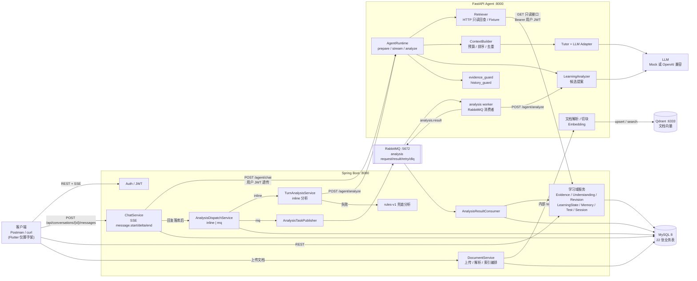

# 系统架构（当前代码，2026-10-27）

本文只描述**仓库里已经能运行的代码**。没有接线的能力会明确标注为「未实现」，
不把设计文档里的目标画成已完成。

## 1. 运行时组件

| 组件 | 技术 | 当前职责 | 不负责 |
| --- | --- | --- | --- |
| 客户端 | Postman / curl；`flutter/ails_flutter` 仍是 Flutter 脚手架 | 发 REST 请求、读 SSE | 没有业务页面，不能作为交付前端 |
| Spring Boot | Java 17 / Spring Boot 3.3.5 / MyBatis-Plus | 鉴权、业务数据唯一写入方、SSE 转发、学习分析编排、文档上传与索引编排 | 不直接调用 LLM，不做语义判断 |
| FastAPI Agent | Python 3.10+ / FastAPI | 概念识别、检索编排、上下文组装、Tutor 生成、学习分析提案、文档解析/切块/Embedding | 不连 MySQL，不直接写任何业务表 |
| MySQL 8 | InnoDB / utf8mb4 | 22 张业务表；Evidence、Understanding、Revision、LearningState、Memory 等的事实来源 | 不存向量 |
| Qdrant | qdrant-client | 文档切片向量与检索 | 不存业务状态，不作为事实来源 |
| RabbitMQ | RabbitMQ 3.13 | 仅 `ails.analysis.mode=mq` 时的分析任务队列、重试队列、死信队列 | 不参与聊天 SSE，不存业务数据 |
| LLM | Mock 或 OpenAI 兼容 API | 生成教学回答、产出分析提案 | 不是事实来源；提案由 Spring 校验后落库 |

## 2. 图 A：运行时 / 服务架构

### 数据方向

- **业务写入只有一个入口**：Spring。Agent 的 `AnalyzeResult` 是候选，不是写入指令。
- **Agent 的读**：在线聊天时用用户自己的 JWT 调 Spring 只读接口；MQ Worker 用
  与后端一致的 `AILS_INTERNAL_TOKEN` 调内部检索接口。两者都不直接连 MySQL，
  也不会拿服务身份绕过用户鉴权去读别人的数据。
- **文档向量**：Spring 把文件交给 Agent 内部接口；Agent 解析、切块、Embedding 后写入 Qdrant。
- **聊天**：Spring 把用户问题、最近历史、用户 JWT 发给 Agent；Agent 通过 HTTP 回查当前理解、
  记忆、文档和（按需）证据，组装上下文后调用 LLM，再以 SSE 增量返回。
- **分析**：回复落库后才开始；inline 直接调 Agent，mq 先落 PENDING 任务再投递。
  `rules-v1` 是 Agent 不可用时的确定性兜底。

## 3. 两个 HTTP 入口

| 入口 | 调用方 | 作用 | 是否落库 |
| --- | --- | --- | --- |
| `POST /agent/chat` | Spring `HttpPythonAgentGateway` | 生成回答，返回 Agent 内部 SSE（`meta` / `delta` / `done` / `error`） | 否 |
| `POST /agent/analyze` | Spring `TurnAnalysisService` 或 MQ Worker | 产出 Evidence / Understanding 提案 / Memory 候选 / 验证决策 | 否，返回候选 |
| `POST /agent/context/preview` | 调试 / E2E | 只检索与组装上下文，不调模型 | 否 |
| `POST /agent/documents/parse` | Spring 内部接口 | 解析上传文件为文本 | 否 |
| `POST /agent/documents/index` | Spring 内部接口 | 切块、Embedding、写 Qdrant | 否（Qdrant 除外） |

Agent 内部 SSE 与前端 SSE **刻意不同名**：

- Agent → Spring：`meta` / `delta` / `done` / `error`
- Spring → 前端：`message.start` / `message.delta` / `message.end` / `message.error`

`HttpPythonAgentGateway` 负责翻译，排查时不能把两层事件混为一谈。

## 4. 文档检索与学习状态是两条独立输入

`ContextBuilder` 把两类信息放在不同区块、不同优先级：

| 区块 | 来源 | 优先级 | 何时进入 |
| --- | --- | ---: | --- |
| `understanding:{conceptId}` | MySQL `learning_understanding` | 70 | 命中 Concept 且后端返回当前快照 |
| `trajectory:{conceptId}` | MySQL `understanding_revision` + 关联 Evidence | 68 | **仅显式个人复盘** |
| `memory:{id}` | MySQL `memory` | 50 | 检索到可见 Memory |
| `knowledge_status` | 本轮知识检索状态 | 45 | 知识检索非成功时 |
| `knowledge:{chunkId}` | Qdrant 文档切片 | 40 | 文档检索命中且预算允许 |
| `evidence:{id}` | MySQL `learning_evidence` | 20 | 用户质疑依据 / 要求复盘等按需场景 |

两条输入不会互相替代：

- 文档检索回答「资料里怎么说」；学习状态回答「这个用户现在怎么理解」。
- 没有文档时，学习状态仍然可以进入上下文；没有学习状态时，文档仍然可以进入。
- 普通知识问题不注入完整历史轨迹；只有显式复盘才读取 Revision 并精确回查旧 Evidence。

## 5. 明确未实现 / 未接线

| 能力 | 现状 |
| --- | --- |
| Flutter 业务前端 | `flutter/ails_flutter/lib/main.dart` 仍是计数器模板；联调靠 Postman/curl |
| 文档导出 / 导入 / 学习计划 | Controller 返回 501，表结构已在位 |
| 测试作答语义判分 | `TestService` 是长度 + 是否点到概念名的启发式 |
| Memory 向量检索 | 关键词 `LIKE`，`memory.embedding_ref` 未接向量库 |
| 真实模型行为验收 | 本地无 `AILS_LLM_API_KEY`，5.3.2 真实调用为 0；只完成 Mock 与离线回放 |
| 多实例一致性 | Agent 无状态，但 Spring 的分析线程池与 SSE 连接未做分布式协调 |

## 6. 相关文档

- 学习状态生命周期：[LEARNING_LIFECYCLE.md](LEARNING_LIFECYCLE.md)
- 环境与启动：[ENVIRONMENT.md](ENVIRONMENT.md)
- 测试矩阵：[TEST_MATRIX.md](TEST_MATRIX.md)
- 已知限制：[KNOWN_LIMITATIONS.md](KNOWN_LIMITATIONS.md)
- Agent 内部分层：[../../agent/docs/pipeline.md](../../agent/docs/pipeline.md)
- 后端数据与写入语义：[../../backend/backend/README.md](../../backend/backend/README.md)
