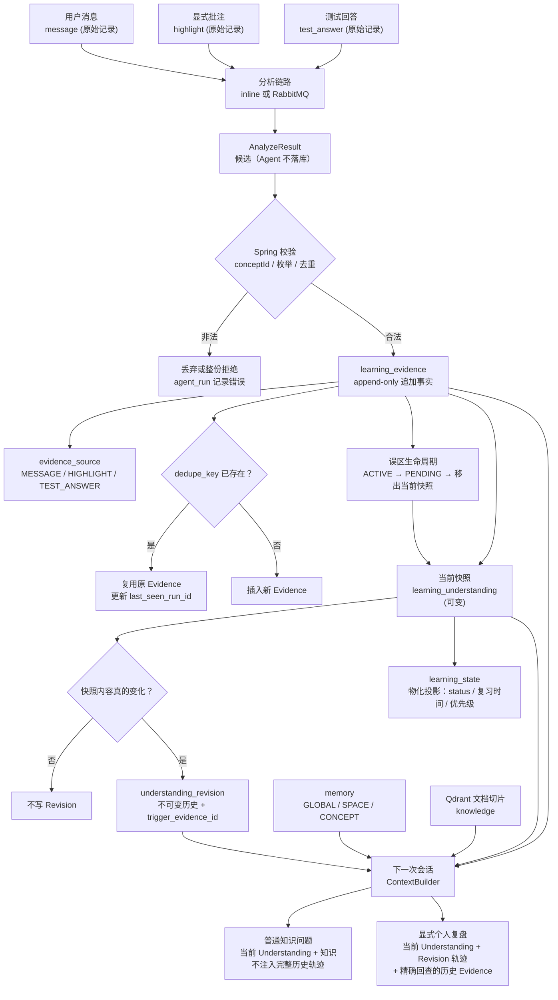

# 学习状态生命周期（当前代码，2026-10-27）

这张图描述的是**一条学习信号从原始记录走到下一次会话上下文**的路径。
四种存储语义必须先分清，否则会把「历史」当成「当前」，或把「投影」当成「判断」：

| 语义 | 表 | 是否可改 | 说明 |
| --- | --- | --- | --- |
| 原始记录 | `message` / `highlight` / `test_answer` | 用户内容可软删；已产生的 Evidence 不随之删除 | 用户原话、显式批注、测试回答 |
| 追加事实 | `learning_evidence` + `evidence_source` | **append-only**，无删除入口 | 认知判断的原子依据；`dedupe_key` 由数据库唯一索引兜底 |
| 当前快照 | `learning_understanding` | 可更新 | 只保存「现在怎么理解」；`misconceptions` 只放当前仍成立的误区 |
| 不可变历史 | `understanding_revision` | **只插入，不更新/删除** | 每次真正变化写一条；`trigger_evidence_id` 指向触发它的 Evidence |
| 物化投影 | `learning_state` | 由 Understanding 单向投影 | 只复制 status、派生复习时间/优先级；不产生独立判断 |
| 长期上下文 | `memory` + `memory_source` | 用 status 管生命周期 | 不是事实来源；检索结果必须带来源与时间，不能被当成当前事实 |

## 1. 图 B：学习状态生命周期

## 2. 每一步由谁负责

| 步骤 | 代码位置 | 关键约束 |
| --- | --- | --- |
| 记录原始消息 / 批注 / 测试回答 | `ChatService`、`HighlightController`、`TestController` | 原始记录是来源，不是判断 |
| 产出候选 | `agent/app/analysis/analyzer.py` | Agent 只返回提案，不写数据库 |
| 校验与去重 | `TurnAnalysisService`、`AgentAnalysisWriteService`、`EvidenceService` | `dedupe_key` 唯一索引是最终保证 |
| 更新当前快照 | `UnderstandingService` | 只能由新 Evidence 演进；没有直接改快照的对外入口 |
| 写 Revision | `UnderstandingService.persistIfChanged` | 内容真正变化才写；JSON 字段先归一化再比较 |
| 投影学习状态 | `LearningStateService.project` | 单向复制 Understanding.status，不产生第二种判断 |
| 写 Memory | `MemoryService` / `AgentAnalysisWriteService` | 作用域由服务端推导；带 `memory_source`，不物理删除 |
| 组装下一次上下文 | `ContextBuilder` | 当前快照优先；历史轨迹只在显式复盘时进入 |

## 3. 误区状态与「已解除」

`MisconceptionStatus` 只有两个值：

- `ACTIVE`：当前仍然存在这个误区；
- `PENDING`：已经出现反向的正确证据，但还没有被独立确认。

「解除」不是第三个枚举值，而是**从 `learning_understanding.misconceptions` 当前数组中移出**。
被移出的误区仍然保留在旧 `understanding_revision.misconceptions` 快照里，所以：

- 当前快照：`misconceptions = []`，`status = DEMONSTRATED`；
- 历史 Revision：仍能看到当时 `ACTIVE` 的误区；
- 复盘时可以同时回答「你当时错在哪」和「你现在已经纠正」。

解除规则是「两条独立正确证据」；规则版分析器不区分反驳的是哪一条误区，
这是已知取舍（见 [KNOWN_LIMITATIONS.md](KNOWN_LIMITATIONS.md)）。

## 4. 当前状态与历史状态不能互相覆盖

- **当前状态不能否认过去**：`DEMONSTRATED` 只说明现在能讲清，不说明「以前没有误解」。
- **历史不能覆盖当前**：旧 Revision 里的 `ACTIVE` 误区，不代表现在仍在犯；
  当前是否有误区只看 `learning_understanding.misconceptions`。
- **没有历史轨迹时**：Agent 必须说「当前可见记录不足，无法确认」，
  不能把当前成功反推成「过去已经越过误区」，也不能断言「过去没有错误」。
- **显式复盘时**：Agent 只能陈述记录里可核对的原话、批注、测试回答、版本状态和时间；
  未记录的心理过程、外部资料使用、改变原因不能补写。

## 5. Memory 与学习状态的关系

Memory 是长期上下文，不是学习状态：

- `GLOBAL`：跨学习空间可见的稳定偏好 / 学习方式；
- `SPACE`：只在某个学习空间内可见；
- `CONCEPT`：只在某个知识点上下文内可见，同时仍受所属空间约束。

检索到的 Memory 会带 `createdAt` / `updatedAt` 等时间信息，并标注为「历史记录」，
避免模型把旧 Memory 当成当前事实。Memory 与当前 Evidence 冲突时，保留来源、不静默覆盖，
当前是否有误区仍以 Understanding 快照为准。

## 6. 相关代码

- 表结构与刻意偏离：[`schema.sql`](../../backend/backend/src/main/resources/schema.sql)
- 理解快照与 Revision：[`UnderstandingService.java`](../../backend/backend/src/main/java/com/ails/backend/service/UnderstandingService.java)
- 学习状态投影：[`LearningStateService.java`](../../backend/backend/src/main/java/com/ails/backend/service/LearningStateService.java)
- 证据去重：[`EvidenceService.java`](../../backend/backend/src/main/java/com/ails/backend/service/EvidenceService.java)
- 轨迹组装：[`agent/app/context/trajectory.py`](../../agent/app/context/trajectory.py)
- 历史回答校验：[`agent/app/history_guard.py`](../../agent/app/history_guard.py)
